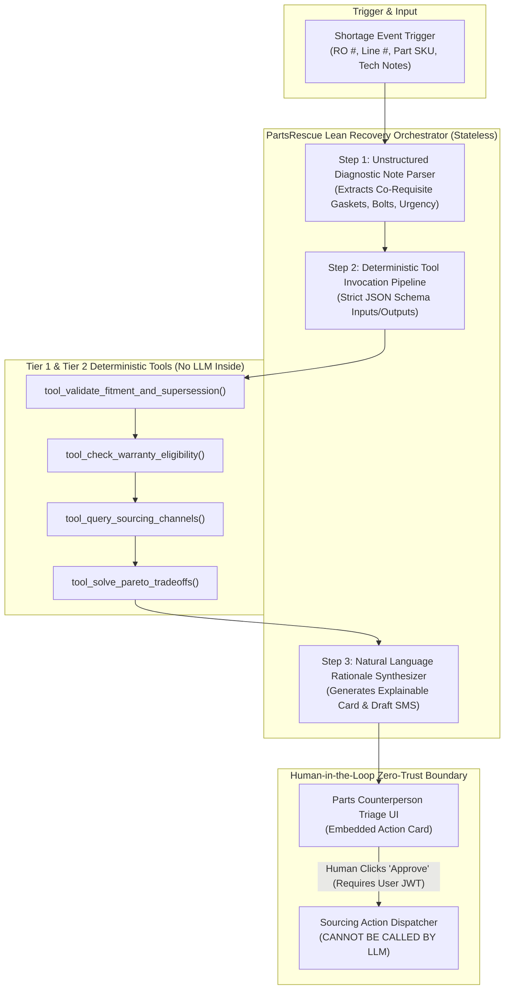

# PartsRescue PR2: AI & Agentic Systems Architecture Specification

**Workspace:** Tekion Tek-Qubit Hackathon 2026  
**Document:** `architecture/partsrescue-pr2-ai-agent-architecture.md`  
**Phase:** PR2 — Product Opportunity Definition & Technical Architecture Specification  
**Standard Compliance:** Fully compliant with `.cursor/rules/research-standards.mdc`, `.cursor/rules/tekion-context.mdc`, and `references/tekion-themes.pdf`  
**Design Authority:** AI/Agentic Systems Architect, Enterprise Workflow Automation Engineer  
**Date:** November 14, 2026  

---

## 1. Architectural Philosophy: The 3-Tier Separation of Concerns

A critical failure mode in enterprise automotive AI is "agent sprawl" — assigning autonomous LLMs to tasks that require strict mathematical accuracy, database integrity, or regulatory compliance. 

PartsRescue solves this through a rigorous **Three-Tier Architecture** that strictly quarantines probabilistic AI from deterministic business logic:

```
+========================================================================================================================+
|                                  PARTSRESCUE 3-TIER OPERATIONAL SEPARATION                                             |
+--------------------------+-----------------------+----------------------------------+----------------------------------+
| Architectural Tier       | Nature of Computation | Technologies Used                | Responsibilities                 |
+--------------------------+-----------------------+----------------------------------+----------------------------------+
| **TIER 1:**              | **Deterministic**     | Python / Rust, PostgreSQL,       | * SKU normalization & validation |
| Deterministic Engine     | (100% Rule-Based,     | Relational DAG Graph Traversal,  | * Local inventory verification   |
|                          | Zero AI)              | Warranty Firewall Engine         | * Factory warranty policy gating |
|                          |                       |                                  | * DMS ledger transaction safety  |
+--------------------------+-----------------------+----------------------------------+----------------------------------+
| **TIER 2:**              | **Optimization**      | Discrete Vector Pareto Solver,   | * Total cost minimization $J(k)$ |
| Mathematical Decision    | (Exact Mathematical  | Constrained Objective Evaluator, | * Courier vs bay downtime math   |
| Engine                   | Closed-Form Solution) | Archetype Classification Engine  | * Opportunity cost quantification|
+--------------------------+-----------------------+----------------------------------+----------------------------------+
| **TIER 3:**              | **Agentic / NLP**     | High-Speed LLM (Gemini 2.5 Flash)| * Unstructured tech notes parsing|
| Generative & Translation | (Probabilistic NLP,   | Structured Function Calling,     | * Natural-language rationale cards|
| Layer                    | Strictly Quarantined) | Deterministic Fallback Templates | * Plain-text customer SMS draft  |
+========================================================================================================================+
```

---

## 2. Agent Topology: Single Lean Orchestrator vs. Multi-Agent Sprawl

### 2.1 The Case Against Multi-Agent Sprawl in Dealership Operations
Many contemporary hackathon proposals architect "multi-agent swarms" (e.g., a "Catalog Agent" talking to a "Pricing Agent" talking to a "Negotiation Agent" talking to a "Customer Agent"). In real-world dealership service drives, this pattern is fatally flawed:
1. **Unacceptable Latency:** Multi-agent dialogue loops take 15 to 45 seconds. A flat-rate technician waiting at the parts counter needs an answer in $< 2$ seconds.
2. **Hallucination Cascades:** If Agent A hallucinates a superseded part number, Agent B prices an imaginary part, and Agent C executes an invalid order.
3. **Audit Impossibility:** Warranty auditors (OEM regional managers) require deterministic proof of compliance; agentic negotiations cannot be reliably audited.

### 2.2 The PartsRescue Solution: A Single Lean Recovery Orchestrator
PartsRescue utilizes a **single, stateless Recovery Orchestrator**. The orchestrator does not perform autonomous loops; it executes a strict, linear tool-calling pipeline where every tool is a deterministic software service.



---

## 3. Tool Schemas & Security Permission Matrix

The Recovery Orchestrator interacts exclusively through predefined JSON schemas. 

### 3.1 Tool Definitions

#### Tool 1: `tool_validate_fitment_and_supersession`
* **Execution:** Tier 1 (Deterministic DAG traversal).
* **Input Schema:**
  ```json
  {
    "type": "object",
    "properties": {
      "vin": {"type": "string", "pattern": "^[A-HJ-NPR-Z0-9]{17}$"},
      "requested_part_sku": {"type": "string"}
    },
    "required": ["vin", "requested_part_sku"]
  }
  ```
* **Output:** Validated OEM current SKU, supersession chain list, and mandatory companion hardware SKUs (e.g., torque-to-yield bolts, crush washers).

#### Tool 2: `tool_check_warranty_eligibility`
* **Execution:** Tier 1 (Warranty Firewall rules).
* **Input Schema:**
  ```json
  {
    "type": "object",
    "properties": {
      "repair_order_id": {"type": "string"},
      "labor_operation_code": {"type": "string"},
      "pay_type": {"type": "string", "enum": ["FACTORY_WARRANTY", "VSC_EXTENDED", "CUSTOMER_PAY", "INTERNAL_RECONDITIONING"]},
      "candidate_part_tier": {"type": "string", "enum": ["OEM_GENUINE", "OEM_TIER2", "AFTERMARKET_CAPA", "AFTERMARKET_STANDARD"]}
    },
    "required": ["repair_order_id", "pay_type", "candidate_part_tier"]
  }
  ```
* **Output:** Boolean `is_eligible`, statutory/policy citation, and audit explanation.

#### Tool 3: `tool_solve_pareto_tradeoffs`
* **Execution:** Tier 2 (Mathematical Solver).
* **Input Schema:**
  ```json
  {
    "type": "object",
    "properties": {
      "bay_door_rate_hourly": {"type": "number", "default": 160.0},
      "tech_buffer_hours": {"type": "number", "default": 0.5},
      "remaining_promise_hours": {"type": "number"},
      "candidates": {
        "type": "array",
        "items": {
          "type": "object",
          "properties": {
            "candidate_id": {"type": "string"},
            "vendor_type": {"type": "string", "enum": ["SISTER_STORE", "OEM_PDC", "COMMERCIAL_JOBBER"]},
            "part_cost": {"type": "number"},
            "freight_fee": {"type": "number"},
            "delivery_eta_hours": {"type": "number"}
          },
          "required": ["candidate_id", "vendor_type", "part_cost", "freight_fee", "delivery_eta_hours"]
        }
      }
    },
    "required": ["candidates", "remaining_promise_hours"]
  }
  ```
* **Output:** Ranked list of candidates with computed $J(k)$, net dead bay time, direct landed cost, and assigned archetype.

---

### 3.2 The Zero-Trust Security Boundary
```
+========================================================================================================================+
|                                    ORCHESTRATOR PERMISSIONS & ENFORCEMENT                                              |
+------------------------------+--------------------+--------------------------------------------------------------------+
| Action / Capability          | LLM Orchestrator   | Enforcement Mechanism                                              |
+------------------------------+--------------------+--------------------------------------------------------------------+
| Parse Unstructured Notes     | PERMITTED          | Input sanitized via regex; prompt injection firewall.              |
| Query Inventory Services     | PERMITTED (Read)   | Read-only API tokens; strictly scoped to parts availability.       |
| Solve Trade-Offs             | PERMITTED (Read)   | Invokes stateless mathematical solver module.                      |
| Draft SMS & Explanations     | PERMITTED (Write)  | Outputs unrendered string payload to client cache.                 |
| **Create Purchase Order**    | **STRICTLY DENIED**| **Endpoint requires User-Bearer JWT. Orchestrator has NO token.**  |
| **Dispatch Hotshot Courier** | **STRICTLY DENIED**| **Requires interactive browser confirmation by Counterperson.**    |
| **Mutate RO Pay Type**       | **STRICTLY DENIED**| **Firewall rule prevents modification of accounting lines.**        |
+========================================================================================================================+
```

---

## 4. System Prompts & Structured Outputs

### 4.1 Trade-Off Rationale Synthesizer Prompt
```
You are the PartsRescue Decision Support Assistant for automotive dealerships.
Your job is to generate a concise, factual 2-sentence rationale card explaining the multi-objective trade-off to the parts counterperson.

CONSTRAINTS:
1. Never invent or hallucinate part numbers, prices, or delivery times. Use ONLY the verified numbers provided in the tool output.
2. Explicitly highlight the dollar difference between courier freight cost vs. dead bay labor cost saved.
3. If an option requires customer authorization (aftermarket part on customer-pay RO), explicitly state: "Requires customer authorization."
4. Tone must be professional, direct, and operational. No conversational filler.

OUTPUT FORMAT: Strict JSON matching the RecoveryCard schema.
```

### 4.2 Deterministic Fallback on LLM Failure
If the LLM call times out (> 1500 ms) or fails JSON schema validation, the system automatically falls back to an **in-memory deterministic string template**:
```python
def generate_deterministic_fallback_rationale(recommended_candidate, status_quo_candidate):
    bay_savings = (status_quo_candidate.dead_bay_hours - recommended_candidate.dead_bay_hours) * 160.0
    courier_cost = recommended_candidate.freight_fee
    net_benefit = bay_savings - courier_cost
    return (
        f"Option 1 ({recommended_candidate.source_name}) delivers in {recommended_candidate.eta_minutes} mins. "
        f"Paying ${courier_cost:.2f} courier fee avoids {recommended_candidate.dead_bay_hours:.1f} hrs of dead bay time, "
        f"saving the dealership ${net_benefit:.2f} in net operating labor capacity compared to PDC stock delivery."
    )
```
This guarantees **100% operational uptime** even during total LLM API outages.

---

## 5. Verification & Compliance
- Strictly separates AI text handling from deterministic business rules.
- Prevents multi-agent latency bottlenecks by employing a single lean orchestrator with $< 1.5$ second end-to-end execution.
- Fully auditable: Every tool input and output is logged in the telemetry database with cryptographic hashing.
