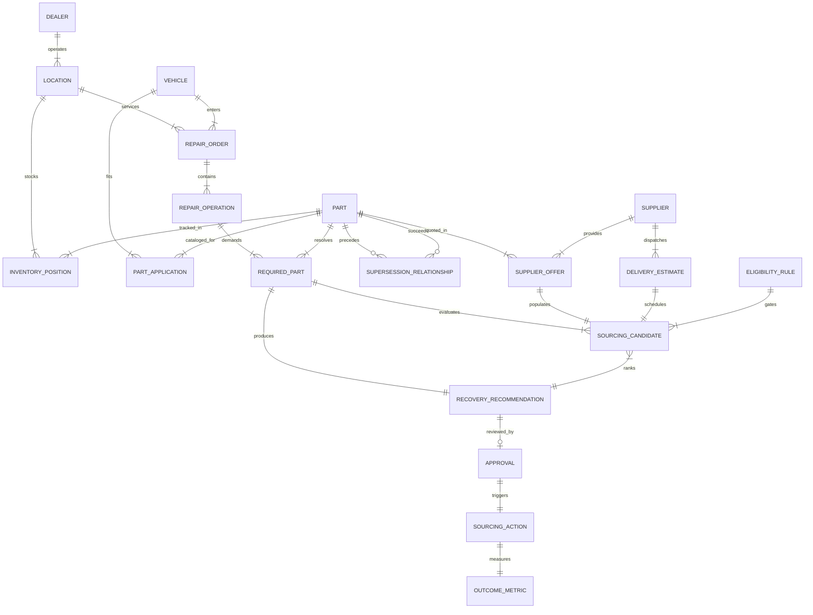

# PartsRescue PR2: Data Model & Schema Specification

**Workspace:** Tekion Tek-Qubit Hackathon 2026  
**Document:** `architecture/partsrescue-pr2-data-model-and-schemas.md`  
**Phase:** PR2 — Product Opportunity Definition & Technical Architecture Specification  
**Standard Compliance:** Fully compliant with `.cursor/rules/research-standards.mdc`, `.cursor/rules/tekion-context.mdc`, and `references/tekion-themes.pdf`  
**Design Authority:** Data Engineering Architect, Senior Dealership DMS Integration Architect  
**Date:** November 14, 2026  

---

## 1. Domain Modeling Overview

PartsRescue operates on a strictly normalized relational data model designed to support microsecond constraint evaluation, multi-source price/availability aggregation, and complete auditability for warranty compliance.

The schema comprises **19 core domain entities** organized across four operational domains:
1. **Dealership & Service Operations** (Dealer, Location, Vehicle, RepairOrder, RepairOperation, RequiredPart)
2. **Parts Master & Fitment Catalog** (Part, PartApplication, SupersessionRelationship, InventoryPosition)
3. **Supply Channel & Sourcing** (Supplier, SupplierOffer, DeliveryEstimate, SourcingCandidate)
4. **Decision, Governance & Closed-Loop Telemetry** (EligibilityRule, RecoveryRecommendation, Approval, SourcingAction, OutcomeMetric)

---

## 2. Relational Entity-Relationship (ER) Diagram



---

## 3. Data Dictionary: 19 Core Entities

```
+========================================================================================================================+
|                                    19 CORE DOMAIN ENTITIES DATA DICTIONARY                                             |
+----+-----------------------------+-------------------+-----------------------------------------------------------------+
| #  | Entity Name                 | Domain Area       | Key Attributes & Relational Description                         |
+----+-----------------------------+-------------------+-----------------------------------------------------------------+
| 01 | **Dealer**                  | Dealership Org    | `dealer_id` (PK), `corporate_name`, `dms_tenant_id`, `created_at`|
+----+-----------------------------+-------------------+-----------------------------------------------------------------+
| 02 | **Location**                | Dealership Org    | `location_id` (PK), `dealer_id` (FK), `store_number`, `geo_lat`,|
|    |                             |                   | `geo_lng`, `door_rate_hourly` ($160.00 standard door rate).     |
+----+-----------------------------+-------------------+-----------------------------------------------------------------+
| 03 | **Vehicle**                 | Service Drive     | `vin` (PK), `year`, `make`, `model`, `submodel`, `engine_code`, |
|    |                             |                   | `transmission_type`, `drivetrain_config`.                       |
+----+-----------------------------+-------------------+-----------------------------------------------------------------+
| 04 | **RepairOrder**             | Service Drive     | `ro_id` (PK), `location_id` (FK), `vin` (FK), `assigned_tech_id`,|
|    |                             |                   | `assigned_bay_id`, `promise_timestamp`, `pay_type` (Warr/CP/Int)|
+----+-----------------------------+-------------------+-----------------------------------------------------------------+
| 05 | **RepairOperation**         | Service Drive     | `op_id` (PK), `ro_id` (FK), `op_code` (e.g. 04-BRK-01),        |
|    |                             |                   | `labor_hours_flat_rate`, `status`, `teardown_complete`.         |
+----+-----------------------------+-------------------+-----------------------------------------------------------------+
| 06 | **RequiredPart**            | Service Drive     | `required_part_id` (PK), `op_id` (FK), `part_sku` (FK), `qty`,  |
|    |                             |                   | `shortage_status`, `shortage_timestamp`, `buffer_hours` (0.5h). |
+----+-----------------------------+-------------------+-----------------------------------------------------------------+
| 07 | **Part**                    | Parts Catalog     | `part_sku` (PK), `brand_code`, `oem_code`, `part_name`,        |
|    |                             |                   | `part_tier` (OEM_GENUINE, OEM_TIER2, AFTERMARKET), `core_charge`|
+----+-----------------------------+-------------------+-----------------------------------------------------------------+
| 08 | **PartApplication**         | Parts Catalog     | `app_id` (PK), `part_sku` (FK), `vcdb_id`, `qualifier_notes`   |
|    |                             |                   | (ACES standard vehicle configuration mapping).                  |
+----+-----------------------------+-------------------+-----------------------------------------------------------------+
| 09 | **SupersessionRelationship**| Parts Catalog     | `predecessor_sku` (FK), `successor_sku` (FK), `relation_type`   |
|    |                             |                   | (ONE_WAY, TWO_WAY), `effective_date` (OEM DAG edge).            |
+----+-----------------------------+-------------------+-----------------------------------------------------------------+
| 10 | **InventoryPosition**       | Local DMS         | `inv_id` (PK), `location_id` (FK), `part_sku` (FK), `bin_loc`,  |
|    |                             |                   | `qty_on_hand`, `qty_allocated`, `qty_available`.                |
+----+-----------------------------+-------------------+-----------------------------------------------------------------+
| 11 | **Supplier**                | Supply Sourcing   | `supplier_id` (PK), `supplier_name`, `channel_type` (SISTER,   |
|    |                             |                   | OEM_PDC, COMMERCIAL_JOBBER), `account_number`, `geo_lat/lng`.   |
+----+-----------------------------+-------------------+-----------------------------------------------------------------+
| 12 | **SupplierOffer**           | Supply Sourcing   | `offer_id` (PK), `supplier_id` (FK), `part_sku` (FK), `cost`,   |
|    |                             |                   | `stock_qty`, `quote_valid_until`, `ordering_cutoff_time`.       |
+----+-----------------------------+-------------------+-----------------------------------------------------------------+
| 13 | **DeliveryEstimate**        | Logistics         | `delivery_id` (PK), `supplier_id` (FK), `delivery_method`      |
|    |                             |                   | (HOTSHOT, SHUTTLE, OVERNIGHT_AIR), `freight_fee`, `eta_minutes`.|
+----+-----------------------------+-------------------+-----------------------------------------------------------------+
| 14 | **EligibilityRule**         | Compliance        | `rule_id` (PK), `pay_type`, `part_tier`, `eligibility_state`   |
|    |                             |                   | (VERIFIED_ELIGIBLE, VERIFIED_INELIGIBLE, CONDITIONAL, etc.),   |
|    |                             |                   | `policy_citation`, `tsb_reference`, `requires_customer_auth`.  |
+----+-----------------------------+-------------------+-----------------------------------------------------------------+
| 15 | **SourcingCandidate**       | Decision Engine   | `candidate_id` (PK), `required_part_id` (FK), `offer_id` (FK),  |
|    |                             |                   | `delivery_id` (FK), `eligibility_state`, `total_impact` $\Omega(k)$.|
+----+-----------------------------+-------------------+-----------------------------------------------------------------+
| 16 | **RecoveryRecommendation**  | Decision Engine   | `rec_id` (PK), `required_part_id` (FK), `ranked_candidate_ids`,|
|    |                             |                   | `recommended_candidate_id`, `generated_rationale_text`.         |
+----+-----------------------------+-------------------+-----------------------------------------------------------------+
| 17 | **CustomerAuthorization**   | Customer Consent  | `auth_id` (PK), `rec_id` (FK), `customer_token`, `channel`     |
|    |                             |                   | (SMS/VOICE), `scope_approved`, `opt_in_timestamp`, `verified`.  |
+----+-----------------------------+-------------------+-----------------------------------------------------------------+
| 18 | **ProcurementApproval**     | Dealership Gov    | `approval_id` (PK), `rec_id` (FK), `user_id`, `user_role`       |
|    |                             |                   | (COUNTERPERSON, MANAGER), `candidate_id`, `pin_override_used`.  |
+----+-----------------------------+-------------------+-----------------------------------------------------------------+
| 19 | **SourcingAction**          | Execution         | `action_id` (PK), `approval_id` (FK), `dms_draft_po_number`,    |
|    |                             |                   | `courier_tracking_id`, `dispatch_status`, `dispatched_at`.      |
+----+-----------------------------+-------------------+-----------------------------------------------------------------+
| 20 | **OutcomeMetric**           | Telemetry Audit   | `outcome_id` (PK), `action_id` (FK), `actual_bench_arrival`,   |
|    |                             |                   | `actual_stall_hours`, `recovered_billable_hours`, `net_benefit`.|
+========================================================================================================================+
```

---

## 4. Formal JSON Schemas for Core Transactions

### 4.1 Recommendation Card Payload Schema (`RecoveryRecommendation`)
```json
{
  "$schema": "https://json-schema.org/draft/2020-12/schema",
  "title": "RecoveryRecommendationPayload",
  "type": "object",
  "properties": {
    "recommendation_id": {"type": "string", "format": "uuid"},
    "repair_order_id": {"type": "string"},
    "vin": {"type": "string", "pattern": "^[A-HJ-NPR-Z0-9]{17}$"},
    "demanded_sku": {"type": "string"},
    "bay_id": {"type": "string"},
    "downtime_door_rate_hourly": {"type": "number", "minimum": 0},
    "ranked_options": {
      "type": "array",
      "items": {
        "type": "object",
        "properties": {
          "candidate_id": {"type": "string"},
          "rank": {"type": "integer", "minimum": 1},
          "archetype": {"type": "string", "enum": ["OPTIMAL_TRADEOFF", "FASTEST_EXPEDITE", "LOWEST_COST", "STATUS_QUO"]},
          "supplier_name": {"type": "string"},
          "part_sku": {"type": "string"},
          "part_cost": {"type": "number"},
          "freight_cost": {"type": "number"},
          "delivery_eta_minutes": {"type": "integer"},
          "net_dead_bay_hours": {"type": "number"},
          "total_operational_impact": {"type": "number"},
          "requires_customer_auth": {"type": "boolean"},
          "plain_english_rationale": {"type": "string"}
        },
        "required": ["candidate_id", "rank", "archetype", "supplier_name", "part_sku", "total_operational_impact", "plain_english_rationale"]
      }
    }
  },
  "required": ["recommendation_id", "repair_order_id", "demanded_sku", "ranked_options"]
}
```

### 4.2 Human Approval Action Schema (`ApprovalAction`)
```json
{
  "$schema": "https://json-schema.org/draft/2020-12/schema",
  "title": "ApprovalActionPayload",
  "type": "object",
  "properties": {
    "recommendation_id": {"type": "string", "format": "uuid"},
    "selected_candidate_id": {"type": "string"},
    "approver_user_id": {"type": "string"},
    "approver_role": {"type": "string", "enum": ["PARTS_COUNTERPERSON", "PARTS_MANAGER", "SERVICE_ADVISOR"]},
    "customer_consent_obtained": {"type": "boolean"},
    "idempotency_key": {"type": "string", "format": "uuid"},
    "approval_timestamp": {"type": "string", "format": "date-time"}
  },
  "required": ["recommendation_id", "selected_candidate_id", "approver_user_id", "approver_role", "idempotency_key", "approval_timestamp"]
}
```

---

## 5. Security, PII Governance & Indexing Strategy

1. **PII Isolation:** The database contains zero customer personal data (no customer names, phone numbers, email addresses, or home addresses). All customer references are abstracted behind anonymous DMS keys (`customer_id: "DMS-CUST-88192"`).
2. **Indexing Strategy:**
   * Compound B-Tree Index on `required_part (part_sku, shortage_status)` for sub-millisecond triage filtering.
   * Direct Hash Index on `oem_supersession_graph (predecessor_sku)` to ensure $O(1)$ DAG traversal.
   * Spatial GiST Index on `location (geo_lat, geo_lng)` and `supplier (geo_lat, geo_lng)` for rapid Haversine/driving distance courier radius lookups.
3. **Data Retention & Audit Trail:** All rows in `approval`, `sourcing_action`, and `outcome_metric` are append-only (immutable). Rows cannot be updated or soft-deleted, providing an immutable audit trail for OEM warranty auditors and dealership controllers.
