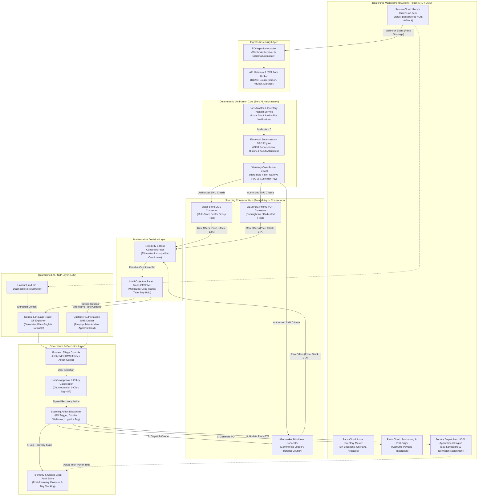

# PartsRescue PR2: Logical System Architecture Specification

**Workspace:** Tekion Tek-Qubit Hackathon 2026  
**Document:** `architecture/partsrescue-pr2-logical-architecture.md`  
**Phase:** PR2 — Product Opportunity Definition & Technical Architecture Specification  
**Standard Compliance:** Fully compliant with `.cursor/rules/research-standards.mdc`, `.cursor/rules/tekion-context.mdc`, and `references/tekion-themes.pdf`  
**Design Authority:** Senior Dealership DMS Integration Architect, AI/Agentic Systems Architect  
**Date:** November 14, 2026  

---

## 1. Architectural Philosophy & Core Tenets

PartsRescue is architected around four non-negotiable enterprise engineering tenets:

1. **Deterministic Primacy:** Business rules, mechanical fitment, warranty eligibility, and financial calculations are executed by deterministic code and mathematical solvers. LLMs are strictly quarantined to unstructured text extraction, natural-language explanation generation, and communication drafting.
2. **Zero-Execution Agency:** The AI orchestrator has zero authority to execute financial commitments, place purchase orders, or alter dealership inventory ledgers. All sourcing actions require an authenticated, human-in-the-loop sign-off.
3. **Non-Invasive DMS Coexistence:** PartsRescue sits as an intelligent sidecar to the core Dealer Management System (specifically Tekion ARC Parts and Service Cloud). It consumes standard webhooks and API events, performs multi-objective evaluation out-of-band, and writes back standard, auditable transactions via sanctioned DMS integration endpoints.
4. **Resilient Failure Decoupling:** Every external dependency (sister-store queries, distributor APIs, courier dispatch, OEM PDCs) is wrapped in circuit breakers with deterministic fallbacks. Network degradation or vendor downtime never freezes the technician's terminal or corrupts the repair order.

---

## 2. 11 Core System Components

```
+========================================================================================================================+
|                                    PARTSRESCUE 11-COMPONENT SYSTEM ARCHITECTURE                                        |
+----+-----------------------------+-----------------------+-------------------------------------------------------------+
| #  | Component Name              | Layer / Subsystem     | Primary Operational Responsibility                          |
+----+-----------------------------+-----------------------+-------------------------------------------------------------+
| 01 | **Frontend Triage Console** | Presentation Layer    | Embedded DMS iframe / side-panel presenting ranked action   |
|    |                             |                       | cards, trade-off sliders, and 1-click approvals.            |
+----+-----------------------------+-----------------------+-------------------------------------------------------------+
| 02 | **API Gateway & Auth Broker**| Ingress & Security    | Validates JWT tokens, manages RBAC (Counter vs Advisor),    |
|    |                             |                       | enforces rate limiting, and routes API payloads.            |
+----+-----------------------------+-----------------------+-------------------------------------------------------------+
| 03 | **RO Ingestion Adapter**    | Ingestion & Event Bus | Subscribes to DMS RO line status change webhooks; normalizes|
|    |                             |                       | parts lines, labor operations, bay IDs, and promise times.  |
+----+-----------------------------+-----------------------+-------------------------------------------------------------+
| 04 | **Parts Master & Inventory**| Local Domain Service  | Queries local store inventory position (On-Hand, Allocated, |
|    | **Position Service**        |                       | Available); retrieves internal cost, list price, bin loc.   |
+----+-----------------------------+-----------------------+-------------------------------------------------------------+
| 05 | **Fitment & Eligibility**   | Deterministic Rules   | Traverses OEM supersession DAGs, checks ACES attributes,    |
|    | **Engine (Firewall)**       | Engine                | and evaluates warranty compliance (OEM vs VSC vs CP).       |
+----+-----------------------------+-----------------------+-------------------------------------------------------------+
| 06 | **Sourcing Connector Hub**  | External Integration  | Concurrently queries external candidate supply channels:    |
|    |                             |                       | Sister-Store DMS, OEM PDC VOR, and Commercial Distributors. |
+----+-----------------------------+-----------------------+-------------------------------------------------------------+
| 07 | **Multi-Objective Decision**| Mathematical Solver   | Solves discrete multi-attribute utility function across     |
|    | **& Optimization Engine**   |                       | landed cost, courier transit time, and dead bay downtime.   |
+----+-----------------------------+-----------------------+-------------------------------------------------------------+
| 08 | **AI Agent Orchestrator**   | Generative NLP Layer  | Extracts unstructured technician notes; generates plain-text|
|    |                             |                       | trade-off rationale cards; drafts customer approval SMS.   |
+----+-----------------------------+-----------------------+-------------------------------------------------------------+
| 09 | **Human Approval & Policy** | Workflow Governance   | Enforces dealership spending limits, requires dual-sign-off |
|    | **Gatekeeper**              |                       | when freight exceeds thresholds, records digital signature. |
+----+-----------------------------+-----------------------+-------------------------------------------------------------+
| 10 | **Sourcing Action**         | Execution Integration | Dispatches PO creation to DMS Parts module, triggers courier|
|    | **Dispatcher**              |                       | dispatch webhook, and publishes shop ETA update to UC01.    |
+----+-----------------------------+-----------------------+-------------------------------------------------------------+
| 11 | **Telemetry & Closed-Loop** | Observability & Audit | Records actual parts arrival time, technician punch-in, bay |
|    | **Audit Store**             |                       | recovery metric, and financial reconciliation delta.        |
+========================================================================================================================+
```

---

## 3. Comprehensive System Architecture Diagram



---

## 4. Component Boundaries & Communication Protocols

### 4.1 Communication Matrix
* **DMS to PartsRescue Ingestion:** Asynchronous HTTPS Webhooks (JSON payload, HMAC-SHA256 signature verification). Fallback: Polling over REST every 60 seconds.
* **Internal Inter-Service Communication:** Lightweight asynchronous REST / gRPC with strict JSON Schema validation. Zero shared in-memory state; services communicate via idempotent event payloads.
* **Sourcing Connector Hub to External Vendors:**
  * Sister-Store DMS: Direct secure API over HTTPS (mTLS) into multi-store inventory database.
  * OEM PDC: Asynchronous EDI / OEM REST API with batch fallback.
  * Commercial Distributor: REST API (Nexpart / PartsTech compatible JSON endpoints) with 15-second strict timeout.
* **PartsRescue to User Presentation:** Secure WebSocket for live real-time triage card delivery to the embedded DMS console.

### 4.2 Security & Isolation Boundaries
1. **Network Segmentation:** The Deterministic Core, Optimization Engine, and Sourcing Connectors execute in a private virtual cluster. Only the API Gateway and Frontend Triage Console are accessible from dealership IP networks.
2. **LLM Sandboxing:** The AI Agent Orchestrator operates as a stateless sidecar. It receives sanitized JSON payloads containing only part descriptions, cost deltas, and delivery times. It has **no network access** to dealership internal databases or DMS transaction APIs.
3. **Data Protection & PII Quarantine:** Customer Personally Identifiable Information (name, phone, address) is completely masked from the Optimization Engine and AI Layer. The SMS Drafter generates a message template containing tokens (`{{CUSTOMER_NAME}}`, `{{ETA}}`, `{{PART_COST}}`) which are resolved locally in the client browser.

---

## 5. DMS Adapter Boundary (MockTekionDmsAdapter Contract)

To guarantee that PartsRescue cannot corrupt core DMS accounting, the integration boundary is formalized via a standardized adapter interface. For the hackathon architecture and prototype, this is implemented as the **`MockTekionDmsAdapter`** (proposed application contract, not an officially verified public Tekion production API):

```
+========================================================================================================================+
|                             MOCK TEKION DMS ADAPTER INTEGRATION BOUNDARY CONTRACT                                      |
+--------------------------+---------------------------------------------------------------------------------------------+
| Integration Point        | Boundary Enforcement Rules                                                                  |
+--------------------------+---------------------------------------------------------------------------------------------+
| **Read Access**          | * Read-only querying of Repair Order header, lines, technician assignments, and parts master.|
|                          | * Local inventory availability query uses read-committed database isolation.                 |
|                          | * No locks are acquired on active repair order records during evaluation.                   |
+--------------------------+---------------------------------------------------------------------------------------------+
| **Write Access**         | * Writes are strictly restricted to adapter-mediated draft endpoints:                       |
|                          |   1. `POST /mock-dms/api/v1/parts/purchase-orders` (Generates UNPOSTED Draft PO).           |
|                          |   2. `PATCH /mock-dms/api/v1/service/repair-orders/{id}/lines/{lineId}` (Status & ETA update).|
|                          |   3. `POST /mock-dms/api/v1/parts/transfers` (Sister-store inventory transfer requisition). |
|                          | * Final PO release and ledger posting requires an authenticated DMS operator.               |
|                          | * Direct database mutations (`INSERT`, `UPDATE`, `DELETE`) are strictly prohibited.        |
+--------------------------+---------------------------------------------------------------------------------------------+
| **Idempotency**          | * All outbound write commands carry a unique UUID `Idempotency-Key: {roId}_{partSku}_{uuid}`.|
|                          | * Retried webhooks or duplicate user clicks cannot create duplicate POs or freight charges.  |
+--------------------------+---------------------------------------------------------------------------------------------+
| **Rollback & Reversal**  | * If an external supplier rejects an order after draft creation, the adapter invokes        |
|                          |   `POST /mock-dms/api/v1/parts/purchase-orders/{id}/cancel` and flags the RO for triage.    |
+========================================================================================================================+
```

---

## 6. Verification & Traceability
- Aligned with Phase PR1 prioritization: Directly implements Problem P7 (Multi-Objective Tradeoff & Recovery Action Recommendation Engine).
- Compliant with `research/partsrescue-pr2-product-definition.md` user personas and non-goals.
- Adheres to `.cursor/rules/research-standards.mdc` by establishing zero-execution AI boundaries and deterministic rules enforcement.
