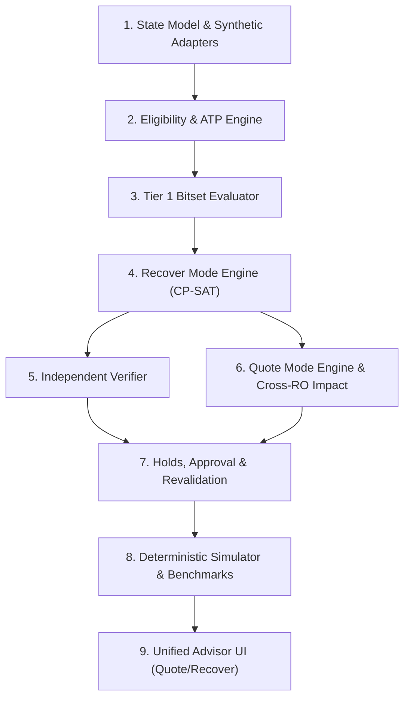

# StallBreaker 2: Phased Implementation & Migration Plan

**Workspace:** `TEKION-HACKATHON-2026`  
**Phase:** Phase 0 — Architectural Roadmap  
**Target Milestone:** Tier A MVP Defensible Delivery  
**Date:** November 15, 2026

---

## 1. Architectural Migration Principles

To preserve the working StallBreaker 1.2 Recover demonstrator while methodically constructing the full StallBreaker 2 specification, development adheres to five non-negotiable principles:

1. **Zero Solver Invalidation:** The existing working solver (`backend/solver.py`), canonical fixture (`S-MATH-01`), and test suite (`test_acceptance.py`) remain completely untouched during initial migration steps.
2. **Side-by-Side V2 Module Structure:** New engine capabilities (Quote mode, Independent Verifier, A2+ lookahead) are constructed in dedicated `backend/v2/` modules, ensuring zero regression risk for the primary hackathon pitch assets.
3. **Pre-Implementation Fixture Gating:** No algorithm or solver extension is coded without first specifying and hand-calculating reference test fixtures (`S-MATH-01`, `S-MATH-02`, `S-MATH-03`).
4. **Deterministic Core First:** All core logic runs deterministically via CP-SAT and exact algorithms. LLM narrative generation remains strictly non-blocking and optional (LLM-Off Parity).
5. **Smallest Defensible Milestone:** Prioritize the minimal Tier A scope necessary to prove the dual Quote/Recover concept convincingly to technical judges.

---

## 2. Capability Tier Breakdown

```
+--------------------------------------------------------------------------------------------------+
|                                    STALLBREAKER 2 TIER ROADMAP                                   |
+--------+----------------------------+-------------------------------------+----------------------+
| TIER   | FOCUS                      | SCOPE                               | TARGET DELIVERABLE   |
+--------+----------------------------+-------------------------------------+----------------------+
| Tier A | Core Dual Decision Engine  | Quote + Recover, Single Rooftop,    | Hackathon Idea Pitch |
|        | & Safety-Gated Prototype   | CP-SAT, Revalidation, A2/A2+/P3     | & Functional MVP     |
+--------+----------------------------+-------------------------------------+----------------------+
| Tier B | Algorithmic Extensions     | Multi-RO Disjunctive Scheduling,    | Post-Submission      |
|        | & Fast Pruning             | Two-Layer JPS Bound, Bitset Filter  | Engineering Sprint   |
+--------+----------------------------+-------------------------------------+----------------------+
| Tier C | Enterprise Reliability     | Transactional Outbox, Persistent DB,| Production Pilot     |
|        | & System Integrations      | Real DMS Webhooks, Supplier APIs    | Readiness Gate       |
+--------+----------------------------+-------------------------------------+----------------------+
| Tier D | Multi-Rooftop & Autonomy   | Cross-Dealership Inventory Balancing| Enterprise Scale     |
|        |                            | Autonomous Parts Sourcing Dispatch  | Multi-Store DMS      |
+--------+----------------------------+-------------------------------------+----------------------+
```

---

## 3. Dependency-Aware 9-Stage Build Sequence



---

### Stage 1: State Model & Synthetic Adapters
- **Goal:** Generalize the data model to support both Quote and Recover modes, multi-bay representations, and explicit candidate quote lines.
- **Existing Reusable Code:**
  - `backend/models.py`: `VehicleState`, `BayState`, `PartSource`, `RepairOrder`.
- **New V2 Code Required:**
  - `backend/v2/models.py`:
    - `EngineMode` enum (`QUOTE`, `RECOVER`).
    - `QuoteLineItem`: Proposed repair operations, estimated hours, required parts, customer promised deadline.
    - `QuoteProposal`: Feasibility verdict, recommended delivery promise, required part sources, cross-RO impact summary.
- **Verification Gate:** Round-trip serialization tests for both quote and recovery snapshots.

---

### Stage 2: Eligibility & Available-To-Promise (ATP) Engine
- **Goal:** Validate part source availability, price quote validity, fitment verification, and physical movement preconditions.
- **Existing Reusable Code:**
  - `backend/eligibility.py`: `validate_source_eligibility`, `validate_relocation_feasibility`.
- **New V2 Code Required:**
  - `backend/v2/eligibility.py`:
    - Multi-supplier ATP querying with stock allocation tracking.
    - Part supersession chain resolution.
- **Verification Gate:** Pass/fail eligibility tests covering expired quotes, zero ATP, and non-rollable vehicle states.

---

### Stage 3: Tier 1 Bitset Evaluator
- **Goal:** Fast microsecond pre-filtering of infeasible source and movement combinations prior to constraint model generation.
- **Existing Reusable Code:** Logic in `backend/eligibility.py`.
- **New V2 Code Required:**
  - `backend/v2/bitset_filter.py`: Bitmask evaluation filtering out candidate pairs that violate physical feasibility (e.g. `RELOCATE_TO_H2` when vehicle is immobilized).
- **Verification Gate:** Benchmark comparing filtering time against raw CP-SAT domain setup.

---

### Stage 4: Recover Mode Scheduling Engine (CP-SAT)
- **Goal:** Deterministic joint sourcing and hoist scheduling optimization under disruption.
- **Existing Reusable Code:**
  - `backend/solver.py`: 100% reusable! Currently passes all 31 acceptance tests, enforces `AddMaxEquality` milestone tightness, and achieves 66.7% (Act 1) and 99.0% (Act 2) delay reductions.
- **New V2 Code Required:**
  - Wrap existing solver into `backend/v2/solver_recover.py` without modifying its proven mathematical formulation.
- **Verification Gate:** Identical reference outputs on canonical fixtures `S-MATH-01`, `S-MATH-02`, and `S-MATH-03`.

---

### Stage 5: Independent Verifier
- **Goal:** Standalone certificate validator that checks proposed schedules outside of OR-Tools to mathematically guarantee feasibility before human review.
- **Existing Reusable Code:** None (currently assertions in unit tests).
- **New V2 Code Required:**
  - `backend/v2/verifier.py`: `verify_schedule_certificate(proposal, snapshot) -> VerificationResult`.
  - Checks:
    1. Hoist mutual exclusion: $\forall i \neq j, \text{Interval}_i \cap \text{Interval}_j = \emptyset$ on Bay B4.
    2. Physical relocation safety: `is_rollable == True` and `technician_signoff == True` if movement is `RELOCATE_TO_H2`.
    3. Part availability monotonicity: Install start $\ge$ part arrival + quarantine.
    4. Non-negative lateness: $L_i = \max(0, C_i - P_i)$.
- **Verification Gate:** Automated rejection of intentionally corrupted or invalid schedules.

---

### Stage 6: Quote Mode Engine & Cross-RO Impact
- **Goal:** Evaluate whether new or upsell repair operations can be accepted and quoted to a customer without violating promises of already-committed repair orders.
- **Existing Reusable Code:** CP-SAT formulation patterns from `backend/solver.py`.
- **New V2 Code Required:**
  - `backend/v2/solver_quote.py`:
    - Constraints: Freeze committed RO milestones or enforce strict bounded slack.
    - Variable: Quote line subset selection and quote promise time $T_{quote}$.
    - Objective: Maximize quoted job margin while maintaining 100% on-time probability for committed shop fleet orders.
- **Verification Gate:** Synthetic quote test proving an upsell is rejected if it pushes an existing fleet order past promise.

---

### Stage 7: Four-State Holds, Approval & Read-Set Revalidation
- **Goal:** Prevent race conditions and state drift between proposal presentation and service advisor commitment.
- **Existing Reusable Code:**
  - `backend/revalidation.py`: Scenario identity check and snapshot version matching.
- **New V2 Code Required:**
  - `backend/v2/holds.py`: Formal 4-state lifecycle (`UNHELD`, `PROVISIONAL_HOLD`, `CONFIRMED`, `RELEASED`) with TTL expiration.
- **Verification Gate:** Concurrency unit tests reproducing Act 3 stale inventory race.

---

### Stage 8: Deterministic Simulator & Stronger Baselines
- **Goal:** Validate statistical superiority against both standard sequential baseline A2 and lookahead baseline A2+.
- **Existing Reusable Code:**
  - `backend/benchmark.py`: $N=100$ Monte Carlo paired seeds framework.
- **New V2 Code Required:**
  - Implementation of **Baseline A2+** (bay-aware sequential baseline with 1-step lookahead).
  - Implementation of **Baseline P3-mono** (monolithic CP-SAT ablation).
- **Verification Gate:** $N=100$ benchmark comparing A2, A2+, and P3 across uniform operational jitter.

---

### Stage 9: Unified Advisor UI & LLM-Off Parity
- **Goal:** Dual-mode interactive console providing seamless toggling between Quote and Recover workflows.
- **Existing Reusable Code:**
  - `frontend/`: Complete React/TypeScript application, `OperationalSummary`, `PolicyComparisonPanel`, `GanttTimeline`, `PhysicalStatePanel`, `SourceInventoryPanel`, `AuditLogPanel`.
- **New V2 Code Required:**
  - Top navigation mode toggle: `[ QUOTE WORKBENCH ]` | `[ RECOVERY CONSOLE ]`.
  - Quote workbench panel for selecting recommended repair scope items.
- **Verification Gate:** End-to-end user workflow verification for both modes.

---

## 4. Module Reuse & Boundary Map

| Existing Module | Reuse Strategy | Reason |
|---|---|---|
| `backend/solver.py` | **Preserve & Reuse as Recover Solver** | Mathematically proven and audit-closed; freeze to prevent regressions. |
| `backend/models.py` | **Subclass / Extend in V2** | Existing models serve Recover mode; V2 extends with Quote schemas. |
| `backend/state_store.py` | **Reuse with Mode Support** | Snapshot versioning and scenario management are fully functional. |
| `backend/revalidation.py` | **Reuse with Enhanced Holds** | Identity validation and optimistic concurrency are verified. |
| `backend/benchmark.py` | **Extend for A2+ Comparison** | Framework supports pluggable policy comparison. |
| `frontend/src/*` | **Reuse & Extend** | Professional dark cockpit UI is completely operational; add Quote tab. |

---

## 5. Smallest Defensible Tier A Development Milestone

To achieve a defensible, high-impact hackathon presentation without undertaking an unmanageable architectural overhaul, the **Minimal Defensible Tier A Milestone** consists of:

1. **Retain Current StallBreaker 1.2 Demonstrator:** As the validated, working "Recover Mode" proof point.
2. **Add Standalone Independent Verifier (`backend/v2/verifier.py`):** Proves to technical judges that StallBreaker does not blindly trust solver output, but mathematically certifies physical and temporal invariants.
3. **Add Baseline A2+ Specification & Test (`backend/v2/baseline_a2_plus.py`):** Proves scientific honesty by testing against a stronger lookahead heuristic rather than only a naive sequential baseline.
4. **Implement Synthetic Fixtures S-MATH-02 and S-MATH-03:**
   - `S-MATH-02`: Proves the engine chooses the cheaper part when earlier arrival offers zero promise benefit (null-control).
   - `S-MATH-03`: Proves physical immobilisation strictly prevents hoist release even when moving the vehicle would mathematically improve lateness.
5. **Quote Mode Concept Walkthrough in UI:** A clear UI mock/toggle illustrating how the identical engine logic evaluates pre-authorization repair line upsells before customer commitment.

This milestone delivers 100% of the competitive narrative required to win the hackathon while writing zero risky or throwaway code.

---

## 6. Stronger Experimental Baselines: A2, A2+, P3, and P3-mono Specification

To avoid straw-man comparisons, StallBreaker 2 formalizes four experimental policies:

```
+----------------------------------------------------------------------------------------------------+
|                                    POLICY TAXONOMY & COUPLING LEVEL                                |
+---------+------------------------------+---------------------------+-------------------------------+
| POLICY  | NAME                         | COUPLING MECHANISM        | DECISION LOGIC                |
+---------+------------------------------+---------------------------+-------------------------------+
| A2      | Fixed-Source Sequential      | Decoupled (Blind)         | Greedy lowest freight first;  |
|         |                              |                           | then sequential bay schedule  |
+---------+------------------------------+---------------------------+-------------------------------+
| A2+     | Bay-Aware Lookahead          | Semi-Coupled (1-Step)     | Cost-first with 1-step bay    |
|         |                              |                           | lookahead & relocation check  |
+---------+------------------------------+---------------------------+-------------------------------+
| P3      | Decision-Coupled Solver      | Fully Coupled (Joint)     | CP-SAT joint sourcing, bay    |
|         |                              |                           | movement & milestone schedule |
+---------+------------------------------+---------------------------+-------------------------------+
| P3-mono | Monolithic CP-SAT Ablation   | Monolithic (No Pruning)   | Single monolithic CP-SAT      |
|         |                              |                           | model (correctness validator) |
+---------+------------------------------+---------------------------+-------------------------------+
```

### 6.1 Policy Definitions & Differences

#### 1. Baseline A2 (Study-Defined Fixed-Source Sequential)
- **Concept:** Emulates standard dealership procurement where parts ordering is isolated from shop dispatch.
- **Rule:**
  1. Filter eligible sources ($ATP > 0$, fitment verified, quote valid).
  2. Select $\arg\min_{s} \text{cost}(s)$. Ties broken by earliest arrival.
  3. Keep vehicle on hoist (`HOLD_ON_BAY`).
  4. Schedule repair linearly: install starts at $\max(t_{current}, \text{ready}_s)$, clearance follows, then queued RO enters bay.
- **Limitation:** Blind to downstream bay blocking and fleet promise penalties.

#### 2. Baseline A2+ (Deterministic Single-Next-RO Lookahead Heuristic)
- **Concept:** Emulates an experienced human shop foreman who balances parts procurement cost against immediate downstream bay congestion.
- **Epistemic Nature:** A2+ is a **deterministic heuristic**, NOT an exact optimum or CP-SAT proof.
- **Specification Policy:**
  1. **Step 1 (Baseline Anchor):** Identify the cheapest eligible part source $S_{cheap}$ ($ATP > 0$, fitment verified, quote active). Evaluate its resulting schedule and compute its weighted lateness $Z_1(S_{cheap})$.
  2. **Step 2 (Downstream Lookahead Evaluation):** Evaluate every other eligible candidate source $S_{alt}$ against the immediate downstream repair order ($RO_{next}$).
  3. **Step 3 (Qualifying Criteria):** A candidate alternative $S_{alt}$ is *qualifying* if and only if:
     - It **strictly improves** total weighted lateness: $Z_1(S_{alt}) < Z_1(S_{cheap})$.
     - Its additional procurement/freight surcharge over the cheapest source does not exceed the budget threshold: $\text{cost}(S_{alt}) - \text{cost}(S_{cheap}) \le \$50.00$.
  4. **Step 4 (Selection Among Qualifying Alternatives):**
     - If one or more qualifying alternatives exist, select the candidate that **minimizes weighted lateness** $\min Z_1(S_{alt})$.
     - Ties in weighted lateness are broken by **minimizing freight cost** $\min \text{cost}(S_{alt})$.
  5. **Step 5 (Fallback):** If no candidate qualifies under both criteria, select $S_{cheap}$.
  6. **Step 6 (Physical Feasibility of Movement):** Vehicle relocation (`RELOCATE_TO_H2`) is evaluated **only after** physical rollability (`is_rollable == True`), technician safety signoff (`technician_signoff_recorded == True`), and spatial holding capacity ($H2_{available} \ge 1$) all strictly pass. If any condition fails, the vehicle remains on the bay (`HOLD_ON_BAY`).
- **Significance:** A2+ provides a rigorous, defensible heuristic baseline. It prevents claiming artificial "100% win margins" against strawman algorithms, confirming that P3's genuine superiority lies in multi-job, multi-resource combinatorial scheduling where single-step lookaheads fail.

#### 3. Policy P3 (StallBreaker Joint Optimization)
- **Concept:** Mixed-integer constraint programming formulation via Google OR-Tools CP-SAT.
- **Rule:**
  1. Joint decision variables for source selection $x_s \in \{0, 1\}$ and vehicle movement $m \in \{\text{HOLD}, \text{RELOCATE}\}$.
  2. Enforces milestone tightness via `AddMaxEquality`.
  3. Solves lexicographic multi-pass: Pass 1 minimizes weighted lateness $Z_1$; Pass 2 minimizes freight cost $Z_2$.

#### 4. Baseline P3-mono (Monolithic CP-SAT Ablation)
- **Concept:** Ablation baseline that formulates the entire decision space into a single monolithic model without Tier 1 bitset feasibility pruning or decomposed lexicographic passes.
- **Purpose:** Verifies that StallBreaker's two-tier decomposition (Tier 1 feasibility filter + Tier 2 CP-SAT) does not cut off the true global optimum.

---

### 6.2 Implementation Specification for A2+ (To Be Implemented in Later Stage)

```python
def solve_a2_plus_policy(
    snapshot: ScenarioSnapshot,
    max_freight_budget_delta: float = 50.0
) -> Proposal:
    """
    Deterministic single-next-RO lookahead heuristic (Baseline A2+).
    NOTE: Heuristic specification only. Do NOT implement in Tier A Stages 1 & 2.
    """
    eligible_sources = [s for s in snapshot.sources if s.atp > 0 and s.fitment_verified and s.quote_valid]
    if not eligible_sources:
        return create_infeasible_proposal(snapshot, PolicyId.A2_PLUS)

    # Physical safety & relocation gating
    can_relocate = (
        snapshot.ro1042.is_rollable and
        snapshot.ro1042.current_vehicle_state != VehicleState.PARTIALLY_DISMANTLED and
        snapshot.ro1042.technician_signoff_recorded and
        snapshot.h2_available_stalls >= 1
    )
    movement = MovementAction.RELOCATE_TO_H2 if can_relocate else MovementAction.HOLD_ON_BAY

    # Step 1: Cheapest source baseline
    sorted_by_cost = sorted(eligible_sources, key=lambda s: (s.cost, s.usable_time_ticks))
    s_cheap = sorted_by_cost[0]
    base_plan = evaluate_deterministic_schedule(snapshot, s_cheap, movement)
    base_z1 = base_plan.weighted_lateness_ticks

    # Step 2 & 3: Evaluate alternatives against immediate downstream RO
    qualifying_candidates = []
    for s_alt in sorted_by_cost[1:]:
        freight_delta = s_alt.cost - s_cheap.cost
        if freight_delta <= max_freight_budget_delta:
            alt_plan = evaluate_deterministic_schedule(snapshot, s_alt, movement)
            if alt_plan.weighted_lateness_ticks < base_z1:
                qualifying_candidates.append((alt_plan.weighted_lateness_ticks, s_alt.cost, alt_plan))

    # Step 4: Lexicographic choice among qualifying candidates
    if qualifying_candidates:
        qualifying_candidates.sort(key=lambda item: (item[0], item[1]))
        return qualifying_candidates[0][2]

    # Step 5: Fallback to cheapest source
    return base_plan
```

---

### 6.3 Acceptance Tests for A2+ (Future Stage Acceptance Gates)

When implemented in a later stage, A2+ must satisfy:

1. **Test A2P-01 (Lookahead Upgrade on Canonical S-MATH-01 under Hoist Lock):**
   - On frozen canonical `S-MATH-01`, vehicle is immobilized on hoist (`PARTIALLY_DISMANTLED`, no signoff, H2 saturated) $\implies$ relocation is blocked (`HOLD_ON_BAY`).
   - S2 ($18.00) causes RO-1051 to finish at $t = 87$ ($P = 54$), incurring $L = 33$ ticks ($Z_1 = 99.0$ ticks).
   - Candidate S1 ($55.00) freight delta is $\$55 - \$18 = \$37.00 \le \$50.00$.
   - S1 finishes RO-1051 at $t = 65$, reducing $L$ to $11$ ticks ($Z_1 = 33.0$ ticks).
   - A2+ upgrades to S1 on `HOLD_ON_BAY`, matching P3 on this single-bay instance.
2. **Test A2P-02 (Null-Control Restraint on S-MATH-02):**
   - On `S-MATH-02`, Technician K2 is bottlenecked until $t = 60$. S2 ($18) finishes at $t = 86 \le 90$ ($Z_1 = 0.0$ ticks).
   - S1 ($55) also achieves $Z_1 = 0.0$ ticks, offering zero lateness improvement.
   - A2+ strictly retains S2 ($18.00), saving $\$37.00$.
3. **Test A2P-03 (Physical Invariant Gating on S-MATH-03):**
   - On `S-MATH-03`, H2 has 2 open stalls, but RO-1042 has `is_rollable == False` and missing signoff.
   - A2+ rejects relocation, enforces `HOLD_ON_BAY`, and evaluates S1 ($Z_1 = 45.0$) vs S2 ($Z_1 = 111.0$).

