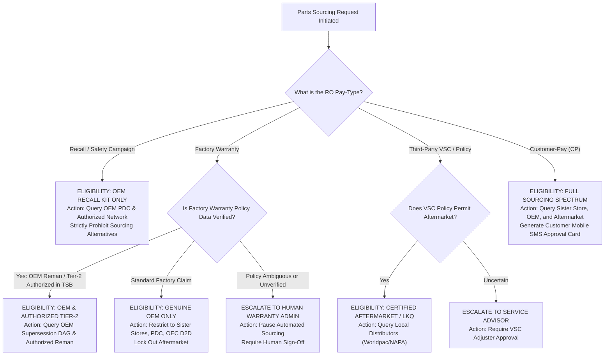

# PartsRescue PR1.1: Warranty Parts Eligibility Framework & Regulatory Deconstruction

**Workspace:** Tekion Tek-Qubit Hackathon 2026  
**Document:** `evaluation/partsrescue-pr1.1-warranty-eligibility.md`  
**Phase:** PR1.1 — Evidence Integrity and Financial Reconciliation Patch  
**Standard Compliance:** `.cursor/rules/research-standards.mdc`, `.cursor/rules/tekion-context.mdc`  
**Audit Authorities:** Automotive Warranty & Compliance Specialist, Dealership Legal Operations Analyst  
**Date:** November 14, 2026  
**Audit Determination:** **BLANKET PROHIBITIONS REPLACED; SIX WORK ORDER REPAIR CATEGORIES PARTITIONED; CONSERVATIVE ELIGIBILITY DECISION FRAMEWORK ESTABLISHED**

---

## 1. Executive Correction: Moving Beyond Blanket Prohibitions

In earlier research drafts, the operational constraint regarding factory warranty was summarized using blanket statements such as: *"Aftermarket parts are strictly forbidden on all warranty repairs under all circumstances."*

Under `.cursor/rules/research-standards.mdc`, this statement is **overly generalized and legally incomplete**. 

While franchised dealerships performing factory-reimbursed warranty work are contractually required to use OEM-authorized components to obtain manufacturer reimbursement, the legal and operational landscape is nuanced across consumer rights, OEM multi-tiered product lines, third-party service contracts, and goodwill policy adjustments.

> [!NOTE]
> **LEGAL DISCLAIMER:**  
> This framework provides an operational classification of dealership manufacturer reimbursement practices and repair-order categories. It does **not** constitute formal legal advice or statutory legal interpretation.

---

## 2. Deconstruction of Six Work Order Categories

To ensure compliance without unnecessarily blocking alternative sourcing, PartsRescue AI partitions repair orders into six distinct billing classifications:

```
+========================================================================================================================+
|                                    SIX WORK ORDER CLASSIFICATIONS & SOURCING ELIGIBILITY                               |
+----+----------------------+-------------------+-----------------------------+------------------------------------------+
| #  | Repair Category      | Typical Payer     | Governing Authority         | Sourcing Eligibility & Restrictions      |
+----+----------------------+-------------------+-----------------------------+------------------------------------------+
| 01 | **NHTSA Safety &**   | Vehicle           | Federal Motor Vehicle Safety| **OEM REMEDY ONLY.** Zero substitution   |
|    | **Emissions Recalls**| Manufacturer      | Standards (49 U.S.C. § 301) | permitted. Must use serialized OEM kit.  |
+----+----------------------+-------------------+-----------------------------+------------------------------------------+
| 02 | **Standard Factory** | Vehicle           | Bilateral OEM Dealer Sales  | **OEM & OEM-AUTHORIZED REMAN ONLY.**     |
|    | **Warranty**         | Manufacturer      | and Service Agreement       | Non-approved aftermarket parts trigger   |
|    |                      |                   |                             | 100% claim clawback during factory audit.|
+----+----------------------+-------------------+-----------------------------+------------------------------------------+
| 03 | **Factory Goodwill /**| Vehicle Mfr /    | OEM District Service Rep    | **RESTRICTED.** Primarily OEM, but       |
|    | **Policy Adjustments**| Dealer Split      | Policy & Discretionary Fund | factory rep can authorize OEM-tiered line|
|    |                      |                   |                             | (e.g. ACDelco Gold, Omnicraft, bproauto).|
+----+----------------------+-------------------+-----------------------------+------------------------------------------+
| 04 | **Third-Party Vehicle| Independent VSC / | Contractual Policy Language | **AFTERMARKET PERMITTED / MANDATED.**    |
|    | **Service Contracts**| Insurance Carrier | (Mechanical Breakdown Ins.) | Policies frequently require certified    |
|    |                      |                   |                             | aftermarket or LKQ parts to limit claim. |
+----+----------------------+-------------------+-----------------------------+------------------------------------------+
| 05 | **Internal Used Car**| Dealership Sales  | Dealership Internal Policy  | **FULL DEALER DISCRETION.** Dealership   |
|    | **Reconditioning**   | Department (Recon)| & CPO Certification Rules   | balances reconditioning speed vs margin; |
|    |                      |                   |                             | CPO requires OEM; non-CPO uses aftermkt. |
+----+----------------------+-------------------+-----------------------------+------------------------------------------+
| 06 | **Retail Customer-** | Vehicle Owner     | State Repair Acts (e.g. CA  | **FULL CUSTOMER CHOICE.** Customer may   |
|    | **Pay (CP) Repairs** | (Consumer Out-of- | BAR / Bureau of Automotive  | select OEM or certified aftermarket;     |
|    |                      | Pocket)           | Repair Disclosure Rules)    | requires written/digital customer consent|
+========================================================================================================================+
```

---

## 3. Regulatory & Commercial Distinctions

### 3.1 Consumer Rights vs Dealership Reimbursement
* **Consumer Perspective (Magnuson-Moss Warranty Act, 15 U.S.C. § 2302):**  
  Federal anti-tying regulations state that an OEM cannot void a consumer's vehicle warranty merely because an aftermarket part or non-dealer service was used for maintenance, unless the OEM can prove that the aftermarket part directly caused the mechanical failure.
* **Dealership Perspective (Franchise Contractual Compliance):**  
  Magnuson-Moss protects consumers; it does **not** force an OEM to reimburse a franchised dealer for non-OEM parts installed during a manufacturer-paid warranty claim. If a dealership installs an unapproved aftermarket part on a warranty claim, the OEM warranty claims processing system will reject the submission or claw back reimbursement upon audit.

### 3.2 OEM-Approved Tiered Alternative Parts Lines
Major automotive manufacturers have established multi-tiered parts lines that are fully authorized within their brand ecosystems:
* **Ford Motor Company:** Genuine Ford (Assembly line OE) vs Motorcraft (OEM specification) vs Omnicraft (Ford-backed all-makes aftermarket line).
* **General Motors:** GM Genuine Parts (Tier 1 OE) vs ACDelco Original Equipment vs ACDelco Gold (Professional) / Silver (Advantage).
* **Stellantis:** Mopar Original Equipment vs bproauto (Stellantis-backed secondary all-makes line).
* **Operational Implication:** When an assembly-line OE part is on national backorder, the OEM's own warranty policy manual frequently permits the substitution of an **approved OEM remanufactured assembly or factory-backed secondary line** (e.g. ACDelco Gold) under specific technical service bulletins (TSBs).

---

## 4. The Conservative Eligibility Decision Framework

PartsRescue AI must never make speculative legal or warranty compliance guesses. It operationalizes a **conservative, deterministic eligibility decision framework**:



### Protocol for Ambiguity: Mandatory Human Escalation
Whenever a repair order's warranty coverage, extended service contract policy language, or OEM remanufacturing authorization is **ambiguous, unverified, or unconfirmed in the DMS**, the system triggers **Safe Degradation**:
1. Automated alternative ordering is **halted**.
2. An **Eligibility Advisory Alert** is flagged for the **Dealership Warranty Administrator** and **Service Manager**.
3. Sourcing proceeds only after human verification confirms that the substitution will not risk manufacturer reimbursement clawbacks.
