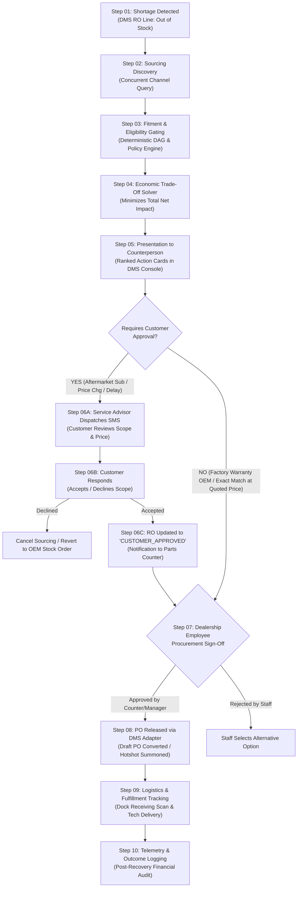

# PartsRescue PR2.1: Approval Authority & Procurement Governance Audit

**Workspace:** Tekion Tek-Qubit Hackathon 2026  
**Document:** `evaluation/partsrescue-pr2.1-approval-authority-audit.md`  
**Phase:** PR2.1 — Architecture Integrity, Economic Model Correction & Technical Consistency Audit  
**Standard Compliance:** Fully compliant with `.cursor/rules/research-standards.mdc`, `.cursor/rules/tekion-context.mdc`, and `references/tekion-themes.pdf`  
**Audit Team:** Enterprise SaaS Product Architect, Technical Red-Team Reviewer  
**Date:** November 14, 2026  
**Audit Status:** CRITICAL REVISION COMPLETE  

---

## 1. Executive Summary & Audit Mandate

In Phase PR2, an architectural contradiction emerged across user workflows and demonstration scripts:
* **The Claim in Architecture:** `architecture/partsrescue-pr2-logical-architecture.md` and `partsrescue-pr2-failure-and-human-approval-design.md` stated that the system operates on a **"Zero-Execution Agency"** model where no autonomous PO can be dispatched without human dealership sign-off.
* **The Contradiction in Demo & Workflow:** `evaluation/partsrescue-pr2-demo-blueprint.md` (Scenario 2) and `research/partsrescue-pr2-operational-workflow.md` stated that when a retail customer replies `"YES"` to an authorization SMS, the system **automatically dispatches a 1-click PO to the vendor**.

This audit identifies this conflation as a **Critical Operational and Governance Defect**. 
A retail customer has legal authority to authorize repairs to their personal vehicle, but **zero legal or operational authority to obligate dealership capital or release a dealership commercial purchase order**.

---

## 2. Decoupling the Two Authorization Domains

PartsRescue PR2.1 formally separates two orthogonal authorization spheres:

```
+========================================================================================================================+
|                                    TWO DISTINCT AUTHORIZATION DOMAINS                                                  |
+--------------------------+----------------------------------------+----------------------------------------------------+
| Dimension                | Domain A: Customer Authorization       | Domain B: Dealership Procurement Authorization     |
+--------------------------+----------------------------------------+----------------------------------------------------+
| **Authorizing Entity**   | Retail Vehicle Owner / Consumer        | Authorized Dealership Employee                     |
|                          | (e.g., Vehicle Driver Sarah M.)        | (Parts Counterperson / Parts Manager)              |
+--------------------------+----------------------------------------+----------------------------------------------------+
| **Scope of Authority**   | * Approving revised repair estimate.   | * Selecting commercial vendor / supplier.          |
|                          | * Approving part substitution tier     | * Incurring dealership accounts payable liability. |
|                          |   (e.g., Tier-1 Aftermarket vs OEM).   | * Approving expedited courier freight charge.      |
|                          | * Accepting revised promise ETA.       | * Releasing PO into dealership accounting ledger.  |
+--------------------------+----------------------------------------+----------------------------------------------------+
| **Operational Impact**   | Updates legal customer repair contract | Binds dealership to supplier invoice and accounts  |
|                          | under state Motor Vehicle Repair Acts. | payable ledger.                                    |
+--------------------------+----------------------------------------+----------------------------------------------------+
| **System Action on 'YES'**| Flags RO line as `CUSTOMER_AUTHORIZED`.| **Creates and transmits commercial purchase order**|
|                          | **DOES NOT DISPATCH PURCHASE ORDER.**  | **to supplier via DMS adapter.**                   |
+========================================================================================================================+
```

---

## 3. The 10-Step Corrected Governance Workflow

To eliminate any possibility of autonomous or customer-triggered procurement, PartsRescue PR2.1 establishes a strict, conditional 10-step sequence:



---

## 4. Conditional Matrix: When is Customer Approval Actually Required?

Customer approval is **not** a universal step. Sourcing operations vary by legal pay-type and repair scope:

```
+========================================================================================================================+
|                                    CUSTOMER AUTHORIZATION NECESSITY MATRIX                                             |
+----+--------------------+-----------------------+---------------------+-------------------+----------------------------+
| #  | Work-Order PayType | Candidate Part Tier   | Price / ETA Impact  | Customer Auth?    | Operational Rationale      |
+----+--------------------+-----------------------+---------------------+-------------------+----------------------------+
| 01 | FACTORY_WARRANTY   | OEM Genuine           | None (Covered 100%) | **NOT REQUIRED**  | Customer owes $0.00; OEM   |
|    |                    |                       |                     |                   | pays. Procure immediately. |
+----+--------------------+-----------------------+---------------------+-------------------+----------------------------+
| 02 | CUSTOMER_PAY       | OEM Genuine           | Delivered within    | **NOT REQUIRED**  | Pre-authorized on original |
|    |                    | (Exact Replacement)   | quoted promise time |                   | signed repair estimate.    |
+----+--------------------+-----------------------+---------------------+-------------------+----------------------------+
| 03 | CUSTOMER_PAY       | Premium Aftermarket   | Lower price or      | **MANDATORY**     | State law requires consent |
|    |                    | (Non-OEM Substitute)  | faster turnaround   |                   | to change part brand/tier. |
+----+--------------------+-----------------------+---------------------+-------------------+----------------------------+
| 04 | CUSTOMER_PAY       | OEM Genuine           | ETA extends past    | **MANDATORY**     | Requires customer consent  |
|    |                    |                       | original promise    |                   | for revised vehicle return.|
+----+--------------------+-----------------------+---------------------+-------------------+----------------------------+
| 05 | INTERNAL_RECON     | Quality Aftermarket   | Internal cost only  | **NOT REQUIRED**  | Used Car Manager pre-auths |
|    |                    |                       |                     |                   | reconditioning matrix.     |
+========================================================================================================================+
```

---

## 5. Absolute Procurement Boundaries & Enforcement Rules

To ensure complete clarity for hackathon evaluators, PartsRescue establishes **two inviolable negative governance rules**:

1. **RULE 1 (Customer Independence):**  
   *Under zero circumstances does a customer SMS response trigger a purchase order.*  
   When a customer replies `"YES"`, the PartsRescue UI displays a green checkmark (`[CUSTOMER CONSENT VERIFIED]`) on the counterperson's triage console. The counterperson must still click **"Approve & Issue PO"** to obligate dealership funds.

2. **RULE 2 (Zero AI Execution):**  
   *Under zero circumstances does an LLM agent trigger, release, or modify a purchase order.*  
   The LLM is quarantined to string synthesis. The outbound purchase order endpoint is guarded by a hardware/session token that only the browser frontend can dispatch upon an explicit human user click.

---

## 6. Audit Verdict & Required PR2 File Modifications
* **Status:** PASS WITH CORRECTIONS.
* **Mandatory Modifications Across PR2 Documents:**
  * In `evaluation/partsrescue-pr2-demo-blueprint.md` (Scenario 2): Correct the script. Customer reply `"YES"` updates RO line status to `CUSTOMER_AUTHORIZED`; Counterperson then clicks `Approve PO & Dispatch`.
  * In `research/partsrescue-pr2-operational-workflow.md` (Step 11 & 12): Split customer consent from dealership procurement sign-off.
  * In `architecture/partsrescue-pr2-data-model-and-schemas.md`: Separate `CustomerAuthorization` entity from `ProcurementApproval` entity.
