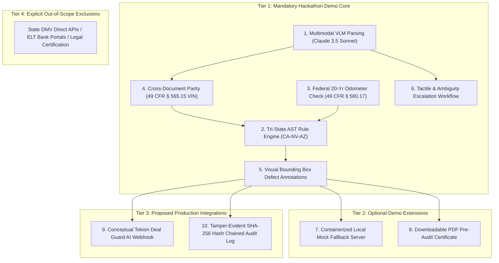

# CrossBorder TitleGuard: Product Scope Freeze Agreement

**Document Version:** 1.0  
**Phase:** 4 — Final Concept Selection, Product Definition & Scope Freeze  
**Concept Reference:** Concept C1 — CrossBorder TitleGuard  
**Status:** FROZEN & LOCKED  
**Authority:** Technical Review Committee & Lead Product Strategist  

---

## 1. Scope Freeze Purpose & Governance

This document establishes the binding product boundary, functional baseline, and technical constraints for **CrossBorder TitleGuard** for the Tekion Tek-Qubit Hackathon 2026.

Following rigorous evaluation against competing concepts (BayFlow Dynamic, CadenceRevive) and deep statutory auditing across California, Nevada, and Arizona, this scope freeze prevents scope creep, maintains focus on the 6-slide presentation deliverable, and guarantees that all architectural and evaluative commitments are mutually coherent.

> [!IMPORTANT]
> **Change Control Policy:** No additions, expansions, or modifications to the functional capabilities or geographic boundaries defined herein are permitted for the hackathon submission without unanimous review by the Product Strategist, Automotive Analyst, and AI Architect.

---

## 2. Frozen Functional Scope: Four-Tier Operational Hierarchy

To ensure absolute engineering feasibility and eliminate ambiguity between prototype demo capabilities and commercial production features, the functional perimeter of CrossBorder TitleGuard is formally structured into four operational tiers:



### 2.1 Tier 1: Mandatory for First Working Demo (Hackathon Demo Scope)
1. **Multimodal Document Parsing & Entity Extraction:** High-accuracy extraction of critical title data (VIN, title number, issue date, state, owner names, odometer readings, notary jurats, lienholder releases) from synthetic scanned multi-page deal jackets using Claude 3.5 Sonnet governed by a proposed Pydantic JSON schema.
2. **Tri-State Statutory Rule Engine:** Deterministic Abstract Syntax Tree (AST) evaluation of interstate transfer rules across California, Nevada, and Arizona, operating independently of LLM probabilistic inference.
3. **Federal Odometer Mandate Verification:** Automated compliance evaluation under 49 U.S.C. § 32705 and 49 C.F.R. § 580.17 (enforcing the 20-year rolling exemption for model year 2011+), monotonic mileage progression, and detection of uncertified mileage alterations.
4. **Cross-Document Parity Reconciliation:** Deterministic cross-referencing between Certificate of Title, Bill of Sale, and DMS deal records, identifying North American VIN check-digit validation errors (49 CFR § 565.15), name variations, and entity mismatches.
5. **Deterministic Visual Defect Annotation:** Real-time generation of normalized 2D bounding boxes mapped to document canvas coordinates, visually highlighting missing notary seals, uncertified erasures, skipped reassignments, and unsigned lines.
6. **Tactile & Physical Ambiguity Escalation Workflow:** Safety mechanism identifying physical artifacts that cannot be certified digitally (e.g., colorless raised dry-embossed notary seals) and routing them to a designated title clerk for physical verification.

### 2.2 Tier 2: Optional Demo Extensions (Presentation Stretch Goals)
7. **Containerized Local Mock Server:** Standby local FastAPI service pre-loaded with synthetic responses to provide an offline presentation fallback harness if auditorium Wi-Fi fails.
8. **Exportable PDF Pre-Audit Summary:** Locally generated summary sheet synthesizing pre-audit findings, statutory citations, and clerk sign-off timestamps.

### 2.3 Tier 3: Proposed Production Integrations (Post-Hackathon Commercial Vision)
9. **Tekion Deal Guard AI Webhook Dispatch:** Proposed / conceptual REST webhook dispatching pre-audit JSON payloads directly to Tekion Deal Guard AI upon commercial integration.
10. **Tamper-Evident Cryptographic Audit Logging:** Cryptographically linked SHA-256 hash-chaining audit trail with digital clerk signatures for dealership compliance defensibility.

---

## 3. Explicit Non-Goals and Exclusions (Tier 4: Preserved Boundaries)

To protect the hackathon team from architectural dilution and implementation overreach, the following items are strictly out of scope:

1. **No Electronic Lien and Title (ELT) Integration or Direct Lender Payoffs:** Active bank liens on trade-ins (representing 40%–50% of trades) are processed via existing electronic lender payoff portals. TitleGuard strictly focuses on customer-held physical paper titles (clear titles, auction acquisitions, trade-ins with paper release). The system explicitly rejects the assumption that all trades carry physical titles.
2. **No Real-Time State DMV Database API Integration:** TitleGuard does not attempt live state title registry queries (e.g., NMVTIS or state DMV mainframes), which suffer from proprietary API access restrictions, state NDAs, and batch latency. TitleGuard validates physical deal jacket documentation at intake.
3. **No Custom Model Pre-Training or Fine-Tuning from Scratch:** The solution avoids expensive, slow deep learning training pipelines. It leverages commercial multimodal foundation models (Claude 3.5 Sonnet / GPT-4o) combined with deterministic algorithmic parsers and rule engines.
4. **No Mobile Consumer Self-Service Scanning Application:** TitleGuard is designed exclusively for dealership B2B workflows (flatbed or document feed scanners at showroom F&I desks and title offices), avoiding the chaos of degraded handheld smartphone photos, shadows, and perspective distortions.
5. **No Legal Compliance Warranty or Indemnification:** The software operates as an administrative pre-audit decision-support tool. It explicitly disclaims legal certification and does not replace statutory dealer compliance responsibilities. The absence of detected clerical defects does not constitute proof of legal ownership.
6. **No Heavy Commercial, Salvage Rebuilder, or Specialty Fleet Processing:** Out-of-scope for hackathon: salvage rebuild inspections, junk certificates, commercial apportioned IRP fleet registrations, and heavy commercial vehicles (Classes 4–8). Strictly scoped to passenger retail automotive (Classes 1–3).
7. **No Automated Title Printing or Physical DMV Document Generation:** TitleGuard audits and validates incoming documentation; it does not print replacement titles, duplicate titles, or secure state title stock.
8. **No 50-State Nationwide Scope:** Scope is strictly frozen to the high-volume Pacific Southwest tri-state corridor: California, Nevada, and Arizona.
6. **No Heavy Commercial, Salvage Rebuilder, or Specialty Fleet Processing:** Out-of-scope for hackathon: salvage rebuild inspections, junk certificates, commercial apportioned IRP fleet registrations, and heavy commercial vehicles (Classes 4–8). Strictly scoped to passenger retail automotive (Classes 1–3).
7. **No Automated Title Printing or Physical DMV Document Generation:** TitleGuard audits and validates incoming documentation; it does not print replacement titles, duplicate titles, or secure state title stock.
8. **No 50-State Nationwide Scope:** Scope is strictly frozen to the high-volume Pacific Southwest tri-state corridor: California, Nevada, and Arizona.

---

## 4. Jurisdiction & Geographic Boundaries

The geographic scope of TitleGuard is strictly frozen to the following three contiguous states:

```
+-----------------------------------------------------------------------------------+
|                            TRI-STATE INTERSTATE CORRIDOR                          |
|                                                                                   |
|    +-----------------------+   Interstate   +-----------------------+             |
|    |      CALIFORNIA       | <============> |        NEVADA         |             |
|    |   (Cal. Veh. Code)    |     Trades     |     (NRS Ch. 482)     |             |
|    +-----------------------+                +-----------------------+             |
|                ^                                        ^                         |
|                |              Interstate                |                         |
|                +============>   Trades   <==============+                         |
|                                    v                                              |
|                        +-----------------------+                                  |
|                        |        ARIZONA        |                                  |
|                        |    (A.R.S. Title 28)  |                                  |
|                        +-----------------------+                                  |
+-----------------------------------------------------------------------------------+
```

- **California (CA):** High-volume export/import hub; strict smog certification timing rules (Cal. Veh. Code § 4000.1), uncertified title alteration penalties (§ 5753), and Reg 262 secure power of attorney requirements.
- **Nevada (NV):** High cross-border volume with CA and AZ; strict reassignment limits (NRS 482.400), notary acknowledgment rules for remote sales, and physical odometer disclosure requirements.
- **Arizona (AZ):** Fast-growing retail corridor; 15-day application timelines (A.R.S. § 28-2051), transaction-specific notary vs MVD/ATP officer witness rules (A.R.S. § 28-2058 / § 28-370), and Form 48-2004 Bill of Sale mandates.

*Expansion to additional states (e.g., Texas, Washington, Utah) is deferred to future commercial product phases.*

---

## 5. Document & Transaction Coverage Matrix

| Document Category | In Scope (Frozen) | Out of Scope (Excluded) |
| :--- | :--- | :--- |
| **Certificates of Title** | Customer-held clear titles (CA, NV, AZ); Out-of-state trade titles; Dealer reassignment supplements. | Electronic titles (ELT-held); Titles with active unreleased financial liens; Salvage rebuild titles. |
| **Bills of Sale** | State-mandated forms (ADOT Form 48-2004, NV Form VP104, CA Reg 135); Dealer wholesale reassignments. | Handwritten scrap paper agreements; Non-state standardized private bills of sale. |
| **Power of Attorney** | Secure vehicle POA forms (CA Reg 262, NV VP136, AZ Form 48-1001 / 48-7104). | General non-vehicular durable POAs; Foreign language POAs without certified translations. |
| **Odometer Disclosures** | Federal Conformity Sections on Titles; Secure reassignment disclosures; Federal 20-year rolling exemption rules. | Pre-1980 non-conforming mileage affidavits; Heavy machinery hour meters. |
| **Special Transactions** | Standard individual-to-dealer retail trades; Dealer-to-dealer wholesale acquisitions. | Deceased owner probate/estate transfers; Bankruptcy court orders; Mechanic's lien sales; Tow yard impound sales. |

---

## 6. Technical Architecture Boundaries

```
[ INTAKE BOUNDARY ]
Deal Jacket Scans (300 DPI Multi-page PDF/TIFF)
       │
       ▼
[ PERCEPTION BOUNDARY ]
Commercial VLM (Claude 3.5 Sonnet) ──► Strict Pydantic JSON Schema
       │
       ▼
[ LOGICAL EVALUATION BOUNDARY ]
Deterministic AST Rule Engine (Local Python/FastAPI) ──► No LLM in Rule Loop
       │
       ▼
[ INTEGRATION BOUNDARY ]
Tekion Deal Guard AI Webhook Payload (JSON REST) ──► No Direct DB Writes to DMS
```

- **Perception:** Restricted to commercial foundation VLMs (Claude 3.5 Sonnet as primary; GPT-4o as benchmark alternative). Zero proprietary model pre-training.
- **Reasoning:** 100% deterministic code (Python Abstract Syntax Trees). The LLM is explicitly forbidden from evaluating legal compliance or deciding rule pass/fail status.
- **Integration:** Downstream integration strictly produces structured webhook payloads compatible with Tekion Deal Guard AI. No direct database access or intrusive hooks into Tekion core accounting modules.

---

## 7. Change Control & Deviation Protocol

Any proposed modification to this scope must follow this mandatory three-step procedure:

1. **Formal Impact Statement:** Author must specify the proposed addition/subtraction, the exact rationale, and the impact on the 6-slide presentation narrative and demo timing.
2. **Tri-Agent Review:**
   - *Automotive Analyst:* Evaluates dealership operational reality and legal validity.
   - *AI Architect:* Evaluates extraction feasibility and latency impact.
   - *Innovation Critic:* Evaluates novelty dilution and red-team vulnerability.
3. **Executive Decision:** Scope modification is rejected by default unless unanimous approval is documented.

---

## 8. Scope Freeze Sign-Off

| Role | Status | Sign-Off Date |
| :--- | :---: | :---: |
| **Lead Product Strategist** | **APPROVED & FROZEN** | Hackathon Phase 4 |
| **Automotive Domain Analyst** | **APPROVED & FROZEN** | Hackathon Phase 4 |
| **AI Solution Architect** | **APPROVED & FROZEN** | Hackathon Phase 4 |
| **Independent Innovation Critic** | **APPROVED & FROZEN** | Hackathon Phase 4 |
