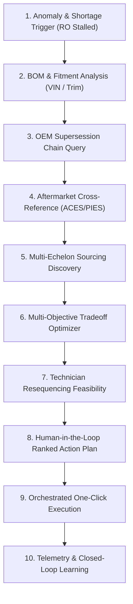

# Phase 4.3 Candidate Feasibility Review: PartsRescue AI (Theme 1 UC04 / UC01)

**Workspace:** Tekion Tek-Qubit Hackathon 2026  
**Document:** `evaluation/phase4.3-partsrescue-feasibility-review.md`  
**Stage:** Phase 4.3 – Final Novelty Verification, Competitive Red-Team & Concept Selection Audit  
**Standard:** Compliant with `.cursor/rules/research-standards.mdc`, `.cursor/rules/tekion-context.mdc`, and Phase 4.3 Specifications  
**Audit Authorities:** AI/ML Solution Architect, Automotive Dealership Operations Expert, Innovation Critic  
**Date of Audit:** November 14, 2026  
**Audit Determination:** **HIGH THEMATIC ALIGNMENT; STRONG AGENTIC DEPTH; DATA ACCESS REQUIRES CURATED SYNTHETIC FIXTURES**

---

## 1. Official Hackathon Alignment & Problem Definition

### 1.1 Mandate Alignment with `references/tekion-themes.pdf`
PartsRescue AI directly addresses the official hackathon problem scope under **Theme 1: AI & Automation – Intelligent Solutions for Operations**:
* **Primary Use Case:** **Theme 1 UC04 — Service Parts Shortage Resolver Agent**.
  * *Official Prompt Summary:* "Proactive detection of parts shortages during active repair orders, automated exploration of alternative parts (OEM supersession, aftermarket fitment), alternative sourcing (sister stores, local vendors), technician schedule resequencing to minimize stalled bay time, and automated customer/advisor communication."
* **Secondary Synergistic Use Case:** **Theme 1 UC01 — Autonomous Appointment & Dispatch Orchestrator**.
  * Dynamically reassigns technician labor queues when physical bay teardowns prevent immediate mechanical reassembly.

### 1.2 The Operational Reality of Parts Stalls in Dealership Service
Dealership fixed operations represent over 45%–50% of total dealership gross profit (NADA Data 2024). However, service efficiency is frequently crippled by mid-repair parts stalls:
1. **The In-Bay Discovery Trap:** A technician disassembles a vehicle on a service lift, only to discover a seized bolt, ruptured seal, or secondary failure requiring an unpredicted replacement part.
2. **Parts Counter Latency:** The parts department marks the line item as backordered or out of stock. The technician stops working, flags off the repair order, and leaves the vehicle on the lift or pushes it outside.
3. **The Idle Bay Penalty:** The lift remains unusable ("lift prison"), or lot porters spend 30 minutes pushing non-running vehicles, destroying technician billable hours and inflating shop turnaround time.

---

## 2. Tekion Ecosystem Fit & Product Coexistence

A critical red-team concern is whether PartsRescue AI merely duplicates existing Tekion modules:

```
+========================================================================================================+
|                                  TEKION ECOSYSTEM COEXISTENCE MATRIX                                   |
+==========================+==================================+==========================================+
| Existing Tekion Module   | Native Capability                | PartsRescue AI Autonomous Role           |
+==========================+==================================+==========================================+
| **Tekion ARC Parts**     | Inventory tracking, bin locations| **Orchestration Layer:** Does not replace|
| **Cloud**                | stock reordering, purchase POs.  | inventory tables. When a stock-out occurs|
|                          | Multi-store inventory visibility.| it executes dynamic multi-source queries.|
+--------------------------+----------------------------------+------------------------------------------+
| **Tekion ARC Service**   | RO creation, technician punch    | **Triage & Recovery Agent:** Detects RO  |
| **Cloud**                | clocks, Smart Tech Matching.     | blockage, evaluates trade-offs, and plans|
|                          | Static dispatch capacity board.  | technician resequencing options.         |
+--------------------------+----------------------------------+------------------------------------------+
| **Tekion Service AI /**  | Customer voice/chat scheduling;  | **Autonomous Resolution:** Does not book |
| **Scheduler AI**         | appointment booking bot.         | appointments. Solves in-progress repair  |
|                          |                                  | logistics between parts and service.     |
+========================================================================================================+
```

**Coexistence Verdict:** PartsRescue AI does not duplicate inventory management or service scheduling; it acts as an **autonomous cross-functional agentic resolver** connecting the parts counter, service dispatch, and customer communications when exceptions occur.

---

## 3. The 10-Step Agentic Recovery Workflow

To verify that PartsRescue AI represents a genuine autonomous agent rather than a hardcoded alert script, its end-to-end operational workflow was defined across 10 discrete steps:



### Detailed Workflow Specifications:
1. **Trigger & Shortage Detection:** Continuous event-driven listener detects when an active RO part status transitions to `BACKORDERED`, `OUT_OF_STOCK`, or `DELAYED_ETA`.
2. **BOM & Fitment Analysis:** Agent ingests vehicle VIN, decodes build data (exact engine displacement, transmission type, trim), and extracts the required OEM part number.
3. **OEM Supersession Chain Query:** Queries the manufacturer part lineage to determine if an updated part number (e.g. revision `AA` $\to$ `AB` $\to$ `AC`) is available in-house or in the OEM distribution network.
4. **Cross-Reference & Aftermarket Fitment:** For customer-pay repairs, queries ACES/PIES compatibility standards to locate certified OEM-grade aftermarket equivalents (e.g., Centric, Denso, Gates).
5. **Multi-Echelon Sourcing Discovery:** Concurrently queries:
   * Local sister stores within the dealer group (intra-group inventory API).
   * Regional OEM Parts Distribution Centers (PDC).
   * Local wholesale commercial vendors (Worldpac, Parts Authority, NAPA).
6. **Multi-Objective Constraint & Tradeoff Evaluation:** Computes an objective function balancing:
   $$\min J = w_1 \cdot \text{Cost Variance} + w_2 \cdot \text{Transit ETA} + w_3 \cdot \text{Bay Idle Cost} + w_4 \cdot \text{Customer Delay}$$
   Subject to: Warranty constraints (OEM parts strictly required for warranty claims) and Customer authorizations (aftermarket allowed only for customer-pay).
7. **Technician & Bay Resequencing Evaluation:** Evaluates physical bay constraints:
   * *Vehicle Mobile:* Directs lot porter to stage vehicle outside; pulls next priority RO into bay.
   * *Vehicle Immobilized on Lift:* Queries dispatch queue to find modular bench tasks (e.g., component rebuilding, electrical diagnostics) the technician can perform while awaiting parts.
8. **Human-in-the-Loop Recommendation Generation:** Formulates a concise, transparent trade-off card for the Service Advisor and Parts Manager (e.g. *"Option A: Sister Store transfer in 45 min ($15 courier fee, 0 bay downtime) vs Option B: Local Aftermarket delivery in 20 min ($35 lower part cost, customer authorization required)"*).
9. **Orchestrated One-Click Execution:** Upon human click approval:
   * Generates parts transfer request / electronic purchase order.
   * Dispatches automated customer SMS approval request if part type or pricing changes.
   * Updates DMS dispatch board and technician time log.
10. **Telemetry & Closed-Loop Learning:** Records resolution speed, advisor acceptance rates, vendor delivery accuracy, and bay recovery hours to tune sourcing weights over time.

---

## 4. Hackathon Data Feasibility vs Production Reality

Under `.cursor/rules/research-standards.mdc`, we must honestly distinguish what a student hackathon team can realistically access versus what requires commercial enterprise licensing:

```
+========================================================================================================+
|                               HACKATHON DATA FEASIBILITY & SIMULATION PLAN                             |
+--------------------------+-----------------------+-------------------------+---------------------------+
| Data Domain              | Production Reality    | Hackathon Feasibility   | Hackathon Solution Design |
+--------------------------+-----------------------+-------------------------+---------------------------+
| **Repair Orders (RO)**   | Live DMS database     | **100% Feasible**       | Synthetic JSON fixtures   |
|                          | connection (Tekion)   |                         | mimicking Tekion RO schema|
+--------------------------+-----------------------+-------------------------+---------------------------+
| **Parts Fitment &**      | Proprietary OEM EPC   | **Curated Subset**      | Pre-compiled dataset of   |
| **Supersession**         | (Snap-on, Microcat)   | **Feasible**            | 5–10 realistic vehicle    |
|                          | Paywalled & protected |                         | repair archetypes.        |
+--------------------------+-----------------------+-------------------------+---------------------------+
| **Aftermarket ACES/**    | Auto Care Association | **Curated Subset**      | Curated mapping table for |
| **PIES Cross-Reference** | commercial database   | **Feasible**            | common wear items (pads,  |
|                          | ($$$ licensing fees)  |                         | alternators, water pumps).|
+--------------------------+-----------------------+-------------------------+---------------------------+
| **Supplier Stock &**     | Enterprise EDI / API  | **Simulated REST APIs** | Mock API server providing |
| **Courier ETAs**         | (OEC, Worldpac, LKQ)  | **Feasible**            | realistic latency, stock, |
|                          | Commercial NDA required|                         | and courier dispatch ETAs.|
+--------------------------+-----------------------+-------------------------+---------------------------+
| **Bay & Technician**     | Live shop floor punch | **Simulated Queue**     | Synthetic shop board with |
| **Dispatch State**       | clocks & dispatch board| **Feasible**           | 8 techs, 12 bays, active  |
|                          |                       |                         | RO job assignments.       |
+========================================================================================================+
```

### Evidentiary Finding on Data Feasibility
* **Crucial Insight:** PartsRescue AI **cannot** be connected to live OEM EPC catalogs or live supplier inventory networks during a student hackathon due to legal and financial barriers.
* **The Hackathon Path:** The team must construct a high-fidelity **curated scenario environment** (5–10 detailed vehicle cases). While entirely valid and standard for hackathon demonstrations, judges must be told transparently that supplier feeds and supersession graphs are simulated via mock endpoints.

---

## 5. Agentic Depth Verification: Why It Is Not Just a Script

A critical question is whether PartsRescue demonstrates genuine agentic reasoning:
1. **Dynamic Tool Selection:** The agent dynamically decides whether to query the OEM supersession chain or the aftermarket cross-reference tool based on the RO's pay type (`WARRANTY` vs `CUSTOMER_PAY`).
2. **Multi-Objective Optimization:** It does not simply select the fastest part; it solves a Pareto frontier balancing part acquisition cost, courier expedite fees, customer promise times, and bay holding costs.
3. **Contingency Planning:** If a local sister store declines a transfer or reports a stock discrepancy, the agent dynamically replans and falls back to technician labor resequencing.
4. **Structured Reasoning Output:** Every recommendation provides a clear chain of reasoning ("Selected Sister Store B over Wholesale Distributor C because $15 courier fee is 82% less than the $85 hourly cost of an idle technician on a stalled lift").

---

## 6. Audit Conclusion

PartsRescue AI is an exceptionally well-aligned, technically sophisticated concept that fits the exact wording of **Theme 1 UC04**. Its agentic architecture is compelling and commercially valuable. Its primary vulnerability lies in the necessity of relying on curated synthetic data fixtures rather than live external parts catalog APIs.
