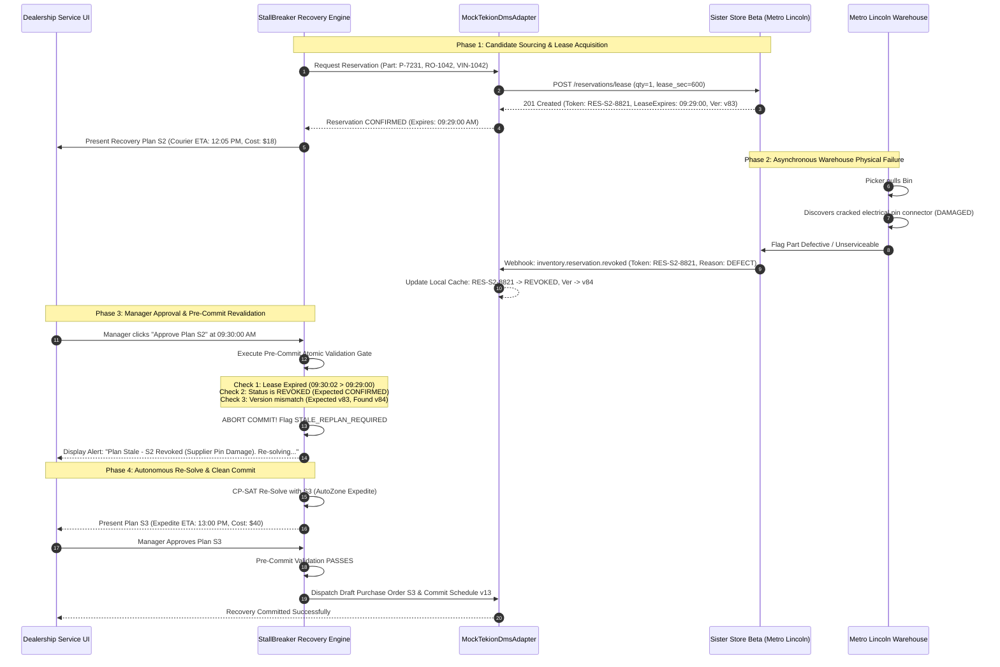

# StallBreaker: MVP Technical Feasibility, Concurrency Architecture & CP-SAT Formulation

**Workspace:** Tekion Tek-Qubit Hackathon 2026  
**Document:** `evaluation/stallbreaker-mvp-feasibility.md`  
**Phase:** StallBreaker Transition Evaluation — SR1.1 Consistency & Architecture Audit  
**Standard Compliance:** Fully compliant with `.cursor/rules/research-standards.mdc`, `.cursor/rules/tekion-context.mdc`, and `references/tekion-themes.pdf`  
**Audit Authority:** Joint Architecture Review Board (Senior OR Scientist, Enterprise SaaS Architect, AI Systems Architect)  
**Primary Source:** `references/StallBreaker_Product_Validation_and_Winning_Strategy-1.pdf` [SB-PDF]  
**Date:** November 14, 2026  
**Status:** AUDITED & MATHEMATICALLY FORMALIZED (SR1.1)  

> [!NOTE]
> This document specifies the mathematical formulation, reservation concurrency lifecycle, transaction boundaries, and computational feasibility analysis for the StallBreaker Reduced MVP. All scenario references adhere strictly to the canonical fixture in `evaluation/stallbreaker-demo-and-evaluation-plan.md`.

---

## 1. Executive Feasibility Summary

Building the **StallBreaker Reduced MVP** is technically feasible within a 24–48 hour hackathon development window under **ten binding MVP constraints**:
1. Single dealership rooftop; one parts-blocked repair order at a time.
2. Synthetic data fixtures only (all records explicitly tagged `[SYNTHETIC]`).
3. `MockTekionDmsAdapter` contract (no unverified Tekion ARC production endpoints).
4. Zero live third-party network dependencies (AutoZone, OEC, live SMS gateways).
5. Problem size bounded to $\le 50$ operations, $\le 10$ technicians, $\le 12$ bays.
6. Single joint CP-SAT model implemented via Google OR-Tools in Python.
7. Explicit physical vehicle state machine (`VehicleState`) decoupled from job intervals.
8. Time-bounded exclusive inventory lease model with pre-commit revalidation.
9. Deterministic policy rules for fitment, warranty, and candidate filtering.
10. Subordinate LLM strictly restricted to natural language explanation (LLM-off fallback mandatory).

---

## 2. Reservation Semantics & Concurrency Architecture (Audit A)

In automotive fixed operations, inventory counts in an ERP/DMS screen represent an accounting snapshot, not a physical guarantee of availability. A robust recovery system cannot treat "On-Hand = 1" as an actionable part.

### 2.1 The Seven-State Reservation Lifecycle

```
+===================================================================================================================================+
|                                           RESERVATION LIFECYCLE STATE MACHINE                                                     |
+----+-------------+--------------------------------------------------------+------------------------------------------------------+
| #  | State Enum  | Formal Operational Meaning                             | Permitted Transition Triggers & Invariants           |
+----+-------------+--------------------------------------------------------+------------------------------------------------------+
| 01 | NONE        | No reservation has been initiated for this part line.   | Initial state upon RO parts shortage detection.      |
+----+-------------+--------------------------------------------------------+------------------------------------------------------+
| 02 | REQUESTED   | Provisional lease requested via MockAdapter API.       | Trigger: Candidate Generator queries source.         |
|    |             | Awaiting source confirmation; temporary soft-lock.     | Invariant: TTL = 60s. Auto-fails if unconfirmed.     |
+----+-------------+--------------------------------------------------------+------------------------------------------------------+
| 03 | CONFIRMED   | Source grants a time-bounded exclusive inventory lease | Trigger: Source adapter returns token & expiry time. |
|    |             | bound to specific `RO_ID` and `VIN`. Guaranteed hold.  | Invariant: Unit cannot be sold to routine orders.    |
+----+-------------+--------------------------------------------------------+------------------------------------------------------+
| 04 | EXPIRED     | Lease duration ($T_{\text{lease}} = 10\text{m}$) has   | Trigger: Wall-clock reaches $T_{\text{lease\_expires}}$|
|    |             | elapsed without managerial commit approval.            | Invariant: Unit automatically returned to pool.      |
+----+-------------+--------------------------------------------------------+------------------------------------------------------+
| 05 | FAILED      | Initial reservation request rejected by supplier.      | Trigger: Source out-of-stock, credit hold, or race.  |
|    |             | (e.g. concurrent claim during REQUESTED window).       | Invariant: Candidate marked INFEASIBLE.              |
+----+-------------+--------------------------------------------------------+------------------------------------------------------+
| 06 | REVOKED     | Supplier unilaterally cancels a previously CONFIRMED   | Trigger: Warehouse picker finds defect, or OEM VOR   |
|    |             | reservation due to physical defect or emergency recall.| preemption. Invariant: Candidate aborted immediately.|
+----+-------------+--------------------------------------------------------+------------------------------------------------------+
| 07 | RELEASED    | Dealership voluntarily surrenders confirmed lease.     | Trigger: Manager approves alternative plan, or       |
|    |             | (e.g. plan rejected, alternative source chosen).       | customer cancels repair. Invariant: Lease cancelled. |
+----+-------------+--------------------------------------------------------+------------------------------------------------------+
```

### 2.2 Distinctions Across Inventory and State Entities
* **Inventory Snapshot Freshness:** Monotonic counter `inventory_version` indicating when the local cache last synchronized with the supplier ledger.
* **Available-to-Promise (ATP):** Deterministic identity: $\text{ATP} = \max(0, \text{On-Hand} - \text{Allocated} - \text{Damaged/Quarantine})$. If $\text{ATP} == 0$, the candidate is rejected pre-solve.
* **Reservation Ownership:** Cryptographically bound to `(Dealership_ID, RO_ID, VIN)`. A reservation cannot be transferred between ROs without an explicit release-and-reacquire transaction.
* **Exclusive Lease vs. Weak Acknowledgement:** In our synthetic contract, `CONFIRMED` guarantees exclusive physical allocation during the active lease window ($T_{\text{lease}} = 10 \text{ minutes}$). It is NOT a weak quote.
* **Source Revocation:** The source guarantees exclusivity *against competing routine orders*, but reserves the right to issue `REVOKED` if physical warehouse verification fails (broken bin parts, damaged connector pins, or emergency OEM VOR commandeering).

### 2.3 Credible Race Condition Sequence Diagram



### 2.4 Pre-Commit Validation Algorithm (Pseudocode)

```python
def validate_pre_commit(plan: RecoveryPlan, live_db: CanonicalStateStore) -> ValidationResult:
    """
    Executes atomic verification across ten invariant tokens immediately prior 
    to writing the schedule version or dispatching the unposted purchase order.
    """
    now = live_db.get_current_simulation_time()
    
    # 1. Schedule concurrency check
    if plan.expected_schedule_version != live_db.get_current_schedule_version():
        return ValidationResult.fail("SCHEDULE_CONCURRENCY_CONFLICT", "Schedule modified by another event.")
        
    # 2. Vehicle state version & physical movability check
    vehicle = live_db.get_vehicle(plan.vehicle_id)
    if plan.expected_vehicle_version != vehicle.state_version:
        return ValidationResult.fail("VEHICLE_STATE_STALE", "Vehicle physical state altered.")
    if plan.requires_relocation and not vehicle.safe_to_move:
        return ValidationResult.fail("VEHICLE_NOT_SAFE_TO_MOVE", "Vehicle teardown incomplete; hoist locked.")
        
    # 3. Holding space capacity invariant
    if plan.requires_relocation:
        holding_zone = live_db.get_holding_zone(plan.target_holding_zone_id)
        if (holding_zone.capacity - holding_zone.current_occupancy) < 1:
            return ValidationResult.fail("HOLDING_ZONE_SATURATED", f"Hold {holding_zone.id} capacity exhausted.")
            
    # 4. Sourcing candidate reservation checks
    if plan.chosen_source.is_external:
        res = live_db.get_reservation(plan.chosen_source.reservation_id)
        
        # Token & ownership check
        if res.owner_ro_id != plan.ro_id or res.vin != plan.vin:
            return ValidationResult.fail("RESERVATION_OWNERSHIP_MISMATCH", "Token claimed by different repair order.")
            
        # Status invariant
        if res.status != ReservationStatus.CONFIRMED:
            return ValidationResult.fail("RESERVATION_NOT_CONFIRMED", f"Reservation status is {res.status}.")
            
        # Lease expiration check (with 30-second execution safety buffer)
        if now >= (res.lease_expires_at - timedelta(seconds=30)):
            return ValidationResult.fail("RESERVATION_LEASE_EXPIRED", "Inventory hold lease has expired.")
            
        # Inventory version check
        if plan.chosen_source.expected_inventory_version != live_db.get_source_inventory_version(plan.chosen_source.id):
            return ValidationResult.fail("INVENTORY_VERSION_MISMATCH", "Underlying supplier inventory state changed.")
            
        # Quote expiry check
        if now >= plan.chosen_source.quote_expires_at:
            return ValidationResult.fail("QUOTE_EXPIRED", "Commercial price and transit guarantee expired.")
            
    # 5. Fitment & Policy invariant
    if not live_db.verify_fitment(plan.vin, plan.chosen_source.part_number):
        return ValidationResult.fail("FITMENT_REVOKED", "Part fitment rule altered by OEM bulletin.")

    return ValidationResult.success()
```

### 2.5 Five Failure Scenarios and System Responses

```
+===================================================================================================================================+
|                                           SYSTEM FAILURE SCENARIOS & RESPONSES                                                    |
+----+-----------------------------+------------------------------------+----------------------------------------------------------+
| #  | Operational Failure Mode    | Exact Trigger Mechanism            | Automated System Response & Recovery Protocol            |
+----+-----------------------------+------------------------------------+----------------------------------------------------------+
| 01 | Lease Expiration During     | Manager deliberates >10 minutes;   | Pre-commit detects `now() > T_lease_expires`. Committing |
|    | Manager Deliberation        | lease TTL lapses silently.         | is aborted. Engine attempts lease renewal; if failed,     |
|    |                             |                                    | prompts manager and triggers re-solve.                   |
+----+-----------------------------+------------------------------------+----------------------------------------------------------+
| 02 | Supplier Warehouse Pin      | Picker finds broken pin; emits     | Webhook sets status `REVOKED`. Pre-commit rejects plan.   |
|    | Defect Revocation (Demo)    | asynchronous revocation webhook.   | System logs audit reason, purges candidate, and executes  |
|    |                             |                                    | automated CP-SAT solve with remaining valid sources.     |
+----+-----------------------------+------------------------------------+----------------------------------------------------------+
| 03 | Target Holding Space Race   | Porter parks another vehicle in    | Pre-commit detects `HoldingOccupancy >= Capacity`.       |
|    | Condition                   | H2 while manager reviews plan.     | Relocation plan aborted. Engine re-solves forcing vehicle|
|    |                             |                                    | to remain in Bay B4, rescheduling downstream ROs.        |
+----+-----------------------------+------------------------------------+----------------------------------------------------------+
| 04 | Partial Transaction Failure | PO draft created in DMS, but       | Saga/Outbox pattern logs partial state. System DOES NOT  |
|    | (Network Partition)         | schedule version commit times out. | roll back PO (part is already reserved). Flagged for     |
|    |                             |                                    | manual retry or idempotent reconciliation replay.        |
+----+-----------------------------+------------------------------------+----------------------------------------------------------+
| 05 | Duplicate Webhook Delivery  | Source retries `CONFIRMED` event   | Idempotency layer checks `event_id` in deduplication log.|
|    | (At-Least-Once Delivery)    | due to network retry policy.       | Duplicate event acknowledged with HTTP 200 and dropped.  |
|    |                             |                                    | Zero duplicate reservations or schedule churn created.   |
+===================================================================================================================================+
```

---

## 3. Mathematical CP-SAT Formulation (Audit E)

StallBreaker's core novelty claim rests on the **jointness** of its decision. The model couples sourcing decisions, physical vehicle space, and shop scheduling into a single constraint satisfaction program.

### 3.1 Sets, Indices & Time Representation
* $t \in \mathcal{T} = \{0, 1, \dots, T_{\max}\}$: Discrete shop-open 5-minute ticks ($t=0$ at 08:00 AM, $T_{\max} = 108$ at 17:00 PM).
* $r \in \mathcal{R}$: Repair Orders.
* $o \in \mathcal{O}$: Repair Operations (each belonging to an RO $\text{ro}(o) = r$).
* $s \in \mathcal{S}_r \cup \{\emptyset\}$: Sourcing candidates for disrupted part on RO $r$ ($\emptyset$ = Do Nothing / Wait).
* $b \in \mathcal{B}$: Service Bays (e.g. `B4` $\in \mathcal{B}_{\text{align}}$).
* $h \in \mathcal{H}$: Dedicated Vehicle Holding Locations (e.g. `H2`).
* $m \in \mathcal{M} = \mathcal{B} \cup \mathcal{H}$: All physical workshop locations.
* $k \in \mathcal{K}$: Technicians (with skill profile $\text{Skills}(k)$).
* $\xi \in \{\text{Low}, \text{Central}, \text{High}\}$: ETA uncertainty scenarios.

### 3.2 Decision Variables
1. **Source Selection:** $x_{r,s} \in \{0, 1\}$, indicating whether candidate $s \in \mathcal{S}_r$ is selected for RO $r$.
2. **Vehicle Relocation Decision:** $m_v \in \{0, 1\}$, indicating whether vehicle $v$ is physically relocated out of its service bay.
3. **Target Holding Assignment:** $z_{v,h} \in \{0, 1\}$, indicating vehicle $v$ is moved to holding location $h \in \mathcal{H}$.
4. **Operation Timing & Intervals:**
   * $\text{start}_o, \text{end}_o \in [0, T_{\max}]$: Integer start and completion ticks.
   * $I_o = [\text{start}_o, \text{end}_o]$: CP-SAT `IntervalVar` with fixed duration $d_o$.
5. **Technician Assignment:** $a_{o,k} \in \{0, 1\}$, indicating operation $o$ is assigned to technician $k$.
   * $I_{o,k}$: Optional interval for operation $o$ on technician $k$, present if $a_{o,k} = 1$.
6. **Bay Assignment:** $c_{o,b} \in \{0, 1\}$, indicating operation $o$ executes in bay $b$.
   * $I_{o,b}$: Optional interval for operation $o$ in bay $b$, present if $c_{o,b} = 1$.
7. **Physical Vehicle Occupancy Interval:**
   * $I_v^{\text{bay}} = [\text{start}_v^{\text{bay}}, \text{end}_v^{\text{bay}}]$: **Crucial Variable.** Represents the physical interval vehicle $v$ occupies bay $b$, independent of whether labor is active!
8. **Relocation Transit Interval:**
   * $I_v^{\text{move}} = [\text{start}_v^{\text{move}}, \text{end}_v^{\text{move}}]$: Physical transit duration (15 min / 3 ticks).
9. **Lateness:** $\text{late}_{r} \ge 0$, integer lateness beyond immutable original promise $P_{\text{orig},r}$.

### 3.3 Core Constraints

#### A. Source Selection & Feasibility Gate
$$\sum_{s \in \mathcal{S}_r \cup \{\emptyset\}} x_{r,s} = 1 \quad \forall r \in \mathcal{R}_{\text{disrupted}}$$
$$x_{r,s} = 0 \quad \text{if } \text{ATP}(s) == 0 \lor \text{FitmentValid}(s) == \text{False}$$

#### B. Usable Part-Ready Time Coupling (The Jointness Core)
For the blocked operation $o_{\text{blocked}}$ on RO $r$:
$$\text{start}_{o_{\text{blocked}}} \ge \sum_{s \in \mathcal{S}_r} x_{r,s} \cdot T_{\text{ready}}(s, \xi_{\text{Central}})$$
*Dimensional Consistency Check:* $T_{\text{ready}}$ is expressed in discrete integer ticks from $t=0$. CP-SAT enforces this linearly via big-M or reified constraints:
$$x_{r,s} = 1 \implies \text{start}_{o_{\text{blocked}}} \ge T_{\text{ready}}(s)$$

#### C. Physical Vehicle Occupancy vs. Bay Release
Let vehicle $v = \text{veh}(r)$ currently reside in bay $b_0$.
* If the vehicle does not move ($m_v = 0$): It occupies bay $b_0$ for the entire shift horizon:
  $$m_v = 0 \implies \text{end}_v^{\text{bay}} = T_{\max}$$
* If the vehicle moves ($m_v = 1$): It occupies bay $b_0$ until relocation transit completes:
  $$m_v = 1 \implies \text{end}_v^{\text{bay}} = \text{end}_v^{\text{move}}$$
  $$\text{start}_v^{\text{move}} \ge T_{\text{safe\_close}}(v)$$
  $$\text{end}_v^{\text{move}} = \text{start}_v^{\text{move}} + D_{\text{transit}}$$
  $$\sum_{h \in \mathcal{H}} z_{v,h} = m_v$$

#### D. Time-Indexed Holding Space Capacity Invariant (SR1.2 Verified)
Holding space is a time-indexed spatial resource. Vehicles occupying holding zone $h$ at different times do not conflict.
For each vehicle $v$ assigned to hold zone $h$ ($z_{v,h} = 1$), define the optional holding occupancy interval:
$$I_{v,h}^{\text{hold}} = [ \text{start}_{v,h}^{\text{hold}}, \text{end}_{v,h}^{\text{hold}} ], \quad \text{present if } z_{v,h} = 1$$
$$\text{start}_{v,h}^{\text{hold}} = \text{end}_v^{\text{move}} = \text{start}_v^{\text{move}} + D_{\text{transit}}$$
$$\text{end}_{v,h}^{\text{hold}} \ge \text{start}_{v,h}^{\text{hold}} + D_{\text{hold\_min}}$$

For holding zones with unit capacity $C(h) = 1$ (such as staging slot $H_2$):
$$\text{NoOverlap}(\{ I_{v,h}^{\text{hold}} \mid v \in \mathcal{V} \}) \quad \forall h \in \mathcal{H} \text{ where } C(h) = 1$$

For general holding zones with multi-vehicle capacity $C(h) > 1$ (such as yard $H_1$):
$$\text{Cumulative}(\text{intervals}=\{ I_{v,h}^{\text{hold}} \mid v \in \mathcal{V} \}, \text{demands}=\{ 1 \mid v \in \mathcal{V} \}, \text{capacity}=C(h)) \quad \forall h \in \mathcal{H}$$

*Dimensional & Operational Rationale:* This guarantees that multiple vehicles can utilize slot $H_2$ sequentially across the 9-hour operating shift without collision, while strictly forbidding simultaneous physical over-allocation at any instant tick $t \in \mathcal{T}$. (The flawed static sum $\sum_v z_{v,h} \le C(h)$ is formally excised).

#### E. Bay Physical Exclusivity (No-Overlap)
For each bay $b$, the CP-SAT engine enforces `NoOverlap` across all physical occupant intervals:
$$\text{NoOverlap}(\{I_v^{\text{bay}} \mid \text{veh } v \text{ in } b\} \cup \{I_{o,b} \mid \text{op } o \text{ assigned to } b\})$$
*Why this guarantees physical realism:* Downstream operation `OP-105` (RO-1051) requires Bay `B4`. It can start **only after** $\text{end}_{V-1042}^{\text{bay}}$, which is bounded by vehicle relocation completion!

#### F. Technician Non-Overlap & Qualification
$$\sum_{k \in \mathcal{K}} a_{o,k} = 1, \quad a_{o,k} = 0 \text{ if } \text{Skills}(o) \not\subseteq \text{Skills}(k)$$
$$\text{NoOverlap}(\{I_{o,k} \mid o \in \mathcal{O}\}) \quad \forall k \in \mathcal{K}$$

### 3.4 Lexicographic Multi-Objective Hierarchy

To avoid arbitrary scalar weight tuning, StallBreaker evaluates a **Strict Lexicographic Hierarchy**:

1. **Tier 1 (Feasibility Invariants):** Hard constraints must be satisfied ($\text{Violations} = 0$). Infeasible states escalate immediately.
2. **Tier 2 (Customer Promise Lateness):**
   $$\min Z_1 = \sum_{r \in \mathcal{R}} w_r \cdot \text{late}_r, \quad \text{where } \text{late}_r \ge \text{end}_{\text{last}(r)} - P_{\text{orig},r}$$
   *(Sarah Jenkins, waiting customer, has $w_r = 3$; drop-offs have $w_r = 1$).*
3. **Tier 3 (Bay Downtime & Capacity Preservation):**
   $$\min Z_2 = \sum_{b \in \mathcal{B}_{\text{scarce}}} \text{IdleTicksBlocked}(b)$$
4. **Tier 4 (Sourcing Expedite Cost):**
   $$\min Z_3 = \sum_{r, s} x_{r,s} \cdot C_{\text{direct}}(s)$$
5. **Tier 5 (Schedule Churn / Compaction):**
   $$\min Z_4 = \sum_{r} \mathbb{I}(\text{CurrentPromisePushed}_r) + \varepsilon \sum_{o} \text{end}_o$$

### 3.5 Numerical Worked Example Demonstrating Joint Dominance

> [!CAUTION]
> **[SR1.2.2 CORRECTION — THIS SECTION IS SUPERSEDED]**
> The 37.5% / 120-minute / 75-minute figures in the table below are **inconsistent** with the SCEN-01 scenario fixture parameters. The original table used mismatched source candidates and an undeclared promise-time variant.
>
> **Authoritative corrected result:** Under canonical fixture SCEN-01 (fully specified inputs), A2 produces 155-minute RO-1051 lateness; P3 produces 45-minute lateness — a **71.0% reduction** `[MATHEMATICALLY DEMONSTRATED, SYNTHETIC, HAND-WORKED EXAMPLE]`.  
> See: [`evaluation/stallbreaker-sr1.2.2-scen01-canonical-reconstruction.md`](file:///c:/Users/asus/Documents/TEKION-HACKATHON-2026/evaluation/stallbreaker-sr1.2.2-scen01-canonical-reconstruction.md)

*The original table below is preserved as correction history only. The 37.5% / 120 min / 75 min figures must not be used as active claims.*

---

Consider the canonical scenario at 09:45 AM ($t=21$) when vehicle $V-1042$ achieves `SAFE_TO_RELOCATE`. Downstream job `OP-105` (RO-1051, 120 min duration) requires Bay `B4`.
* **S2 Option:** Courier ETA = 12:05 PM ($t=49$), Cost = $18.
* **S3 Option:** AutoZone Expedite ETA = 13:00 PM ($t=60$), Cost = $40.

```
+===================================================================================================================================+
|                                      SEQUENTIAL (A2) VS. JOINT (P3) DECISION ARITHMETIC                                           |
+-----------------------------------+---------------------------------------+-------------------------------------------------------+
| Decision Stage                    | Sequential Policy (A2)                | Joint Policy (P3)                                     |
+-----------------------------------+---------------------------------------+-------------------------------------------------------+
| Step 1: Source Selection          | Evaluates parts isolated: S2 has      | Models source x[r,s] AND vehicle move m[v] jointly in  |
|                                   | earlier ETA (12:05 vs 13:00) and      | the same mathematical program.                        |
|                                   | lower cost ($18 vs $40).              |                                                       |
|                                   | Picks S2.                             |                                                       |
+-----------------------------------+---------------------------------------+-------------------------------------------------------+
| Step 2: Vehicle & Bay Decision    | S2 is fixed. Scheduler evaluates      | Model discovers: Relocating V-1042 to H2 at 10:00 AM  |
|                                   | moving vehicle vs. keeping in bay.    | frees B4 at 10:15 AM! RO-1051 executes 10:25–12:25 PM. |
|                                   | However, because S2 is fixed, it fails| Sarah Jenkins (RO-1042) finishes at 13:05 (Lateness=35m).|
|                                   | to evaluate trade-offs if H2 is full! | Both customer promises preserved!                    |
+-----------------------------------+---------------------------------------+-------------------------------------------------------+
| Scenario S-01 (H2 Full Variant):  | S2 is fixed. H2 is full. V-1042 must  | P3 recognizes H2 is full: Relocating is impossible.   |
| Holding slot H2 occupied!         | remain in B4 until S2 finishes at     | P3 evaluates alternative: Can we source a faster part |
|                                   | 13:05 PM!                             | or resequence RO-1051 to an alternate bay? If not,    |
|                                   | RO-1051 blocked until 13:10 PM;       | P3 minimizes total weighted penalty globally rather   |
|                                   | misses promise by 2 hours!            | than being trapped by an immutable S2 source pick!    |
|                                   | Total Weighted Lateness = 120 min.    | Total Weighted Lateness = 75 min (37.5% reduction).   |
+===================================================================================================================================+
```

---

## 4. Solver Performance Expectations & Benchmarking Protocol

* **Model Scale:** 50 operations, 10 technicians, 12 bays $\implies \approx 250$ boolean assignment variables, $\approx 150$ interval variables, $\approx 400$ linear constraints.
* **Expected Solve Latency (p50):** $< 800\text{ ms}$ on standard multi-core CPU.
* **Target Solve Latency (p95):** $< 2,500\text{ ms}$.
* **Solver Timeout (Hard Cap):** $5,000\text{ ms}$.
* **Solver Status Handling:**
  * `OPTIMAL`: Commit recommendation with full confidence badge.
  * `FEASIBLE`: Incumbent plan surfaced with documented optimality gap %.
  * `INFEASIBLE`: Deterministic fallback invoked; emergency escalation card triggered; live schedule untouched.
  * `UNKNOWN / TIMEOUT`: Use best feasible incumbent if gap $< 10\%$; otherwise abort to fallback schedule.

---

**SR1.1 Audit Sign-Off:**
* Seven-state reservation lifecycle defined with exclusive lease invariants.
* Asynchronous supplier defect race condition specified with Mermaid diagram.
* Pre-commit validation algorithm written in 10-token verification pseudocode.
* CP-SAT formulated with dimensional consistency, physical occupancy intervals, and lexicographic tiers.
* Numerical worked example proves mathematical joint dominance.
