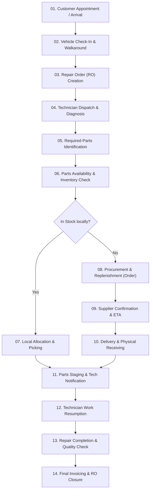

# PartsRescue PR1: Dealership Service & Parts Operational Workflow Analysis

**Workspace:** Tekion Tek-Qubit Hackathon 2026  
**Document:** `research/partsrescue-pr1-dealership-workflow.md`  
**Phase:** PR1 — Deep Dealership Problem Discovery & Operational Validation  
**Standard Compliance:** `.cursor/rules/research-standards.mdc`, `.cursor/rules/tekion-context.mdc`, `references/tekion-themes.pdf`  
**Research Entity:** PartsRescue AI Innovation Research Team  
**Date:** November 14, 2026  
**Focus:** Comprehensive 14-Step Operational Lifecycle & 11 Shortage Delay Scenarios  

---

## 1. Executive Workflow Scope

In automotive franchised retail, the interaction between the **Service Department** (which bills technician labor hours) and the **Parts Department** (which procures, manages, and bills physical replacement parts) represents the primary gross profit engine of the enterprise (accounting for ~45%–50% of total dealership gross margin under NADA benchmarks).

When a service repair requires a replacement part, the operational handoffs between technicians, service advisors, parts counter staff, and external supply chains are complex and interdependent. This document maps the complete 14-step operational lifecycle and analyzes 11 specific shortage scenarios to establish exactly where, how, and why parts bottlenecks disrupt dealership throughput.

---

## 2. The 14-Step Service and Parts Operational Lifecycle



### Detailed Lifecycle Stage Specifications:

1. **Customer Appointment / Vehicle Arrival:** Customer arrives via scheduled appointment (booked online/phone) or unannounced emergency walk-in. Preliminary concerns (symptoms, warning lights, maintenance milestones) are logged.
2. **Vehicle Check-In:** Service Advisor conducts drive walkaround, records odometer reading, checks for body damage, and reviews open OEM recalls via the manufacturer portal.
3. **Repair-Order (RO) Creation:** Service Advisor opens an electronic Repair Order in the Dealer Management System (DMS). Work is segregated into distinct billing lines: Customer-Pay (`CP`), Factory Warranty (`W`), Extended Service Contract (`I`), or Internal (`INT` for used car recon).
4. **Technician Dispatch & Diagnosis:** Shop Dispatcher (or automated DMS dispatch) assigns the RO to a qualified technician based on certification level (e.g., Master Tech, Transmission, Lube/Brake). The technician pulls the vehicle into an assigned service bay and conducts diagnostic testing and physical disassembly.
5. **Required-Parts Identification:** Technician identifies the root-cause failure and specific components requiring replacement. If part numbers are not known, the technician checks the Electronic Parts Catalog (EPC) via VIN filtering or physically walks to the back parts counter to request parts identification from a counterperson.
6. **Parts Availability & Inventory Check:** Parts counterperson enters the VIN and component description into the DMS parts module. The system queries the local dealership inventory master record for physical on-hand quantity (`OH`), allocated quantity (`AL`), and available quantity (`AV`).
7. **Reservation or Allocation (In-Stock Path):** If on-hand stock is available, the counterperson allocates the part number to the specific RO line item, prints a pick ticket, pulls the part from the bin location, and marks the status as staged or billed.
8. **Procurement or Replenishment (Out-of-Stock Path):** If stock is zero or insufficient, the counterperson determines the procurement path:
   * *Stock Replenishment:* Standard weekly replenishment from OEM Parts Distribution Center (PDC) at standard freight rates.
   * *Daily Order / Emergency VOR (Vehicle-Off-Road):* Priority overnight order from OEM PDC carrying emergency freight fees.
   * *Outside Purchase (OP):* Sourcing from local wholesale distributor (e.g., NAPA, Worldpac) or peer dealership.
9. **Supplier Confirmation & Status Logging:** Supplier processes the electronic purchase order (via EDI or portal) and returns an electronic confirmation: either acknowledging shipment with an estimated time of arrival (ETA) or issuing a **Backorder Notice** (national stockout, indefinite delay, or factory production hold).
10. **Delivery and Receiving:** Parts arrive at the dealership loading dock (via overnight OEM logistics truck, freight carrier, or local courier). Parts shipping/receiving clerk unboxes freight, inspects for damage, scans packing slips, and receives the inventory into the DMS.
11. **Parts Staging & Technician Notification:** The DMS or parts clerk matches the received part to the waiting RO line item, tags the part with the RO number, and places it in an RO-specific staging bin. An electronic notification (or shop paging alert) is dispatched to the technician and service advisor.
12. **Technician Work Continuation:** If the vehicle remained on the lift, the technician immediately resumes reassembly. If the vehicle was rolled into a holding yard ("dead storage") to free the bay, a lot porter must locate and tow/drive the vehicle back onto an available lift.
13. **Repair Completion & Quality Check:** Technician finishes installation, tops off fluids, executes calibration/reprogramming, performs a road test, and electronic time-clocks off the repair operation.
14. **Repair-Order Closure:** Service Advisor reviews technician punch times, verifies parts pricing against warranty/retail matrices, presents the final invoice to the customer (or submits digital warranty claim to the OEM), and delivers the vehicle.

---

## 3. Analysis of 11 Shortage & Delay Scenarios

Dealerships do not experience a single monolithic "parts shortage." Bottlenecks diverge significantly based on supply chain tiers, warranty constraints, and physical bay mechanics.

```
+========================================================================================================================+
|                                    11 OPERATIONAL SHORTAGE SCENARIOS COMPARISON TABLE                                  |
+----+--------------------------------+-----------------------+-------------------------+-------------------------------+
| #  | Scenario Definition            | Detection Point       | Primary Decision Owner  | Operational Bottleneck        |
+----+--------------------------------+-----------------------+-------------------------+-------------------------------+
| 01 | Local Stockout (In Network)    | Step 06 (Counter check| Parts Counterperson     | 1–3 hour delay waiting for    |
|    |                                | in DMS)               |                         | hotshot courier from sister st|
+----+--------------------------------+-----------------------+-------------------------+-------------------------------+
| 02 | Sister Store Inventory Lockout | Step 06 (Multi-store  | Parts Manager           | Peer store refuses transfer   |
|    |                                | lookup)               |                         | to protect its own retail stock|
+----+--------------------------------+-----------------------+-------------------------+-------------------------------+
| 03 | OEM National PDC Backorder     | Step 09 (Supplier EDI | Parts Manager & Service | 3–45 day indefinite delay;    |
|    |                                | confirmation)         | Advisor                 | bay stranded or customer in car|
+----+--------------------------------+-----------------------+-------------------------+-------------------------------+
| 04 | Part Discontinued / Superseded | Step 05/06 (Catalog   | Parts Specialist        | Old part number dead; newer   |
|    |                                | entry in EPC)         |                         | rev requires secondary bracket|
+----+--------------------------------+-----------------------+-------------------------+-------------------------------+
| 05 | Incorrect Part Identified      | Step 12 (Tech attempts| Technician & Parts      | Teardown reveals mismatch;    |
|    |                                | physical installation)| Counterperson           | re-ordering resets lead time. |
+----+--------------------------------+-----------------------+-------------------------+-------------------------------+
| 06 | Supplier Ghost Availability    | Step 10 (Receiving box| Receiving Clerk & Parts | Packing slip says shipped; box|
|    |                                | empty or missing line)| Buyer                   | contains wrong item or omitted|
+----+--------------------------------+-----------------------+-------------------------+-------------------------------+
| 07 | Logistics / Transit Delay      | Step 10 (Morning truck| Parts Counterperson     | Freight carrier delayed; shop |
|    |                                | arrives without item) |                         | schedule dismantled for day.  |
+----+--------------------------------+-----------------------+-------------------------+-------------------------------+
| 08 | Emergency VOR Sourcing Needed  | Step 08 (Customer has | Service Manager         | Dealership paying $45/day for |
|    |                                | loaner vehicle / VOR) |                         | rental car; urgent sourcing.  |
+----+--------------------------------+-----------------------+-------------------------+-------------------------------+
| 09 | Multi-RO Stock Competition     | Step 07 (Allocation   | Shop Dispatcher / Parts | 1 part on shelf; 2 customer   |
|    |                                | conflict in DMS)      | Manager                 | vehicles waiting in bays.     |
+----+--------------------------------+-----------------------+-------------------------+-------------------------------+
| 10 | Warranty OEM Restriction       | Step 08 (Sourcing     | Warranty Administrator  | Aftermarket part available locally|
|    |                                | evaluation)           | & Service Advisor       | but OEM rules forbid non-OEM. |
+----+--------------------------------+-----------------------+-------------------------+-------------------------------+
| 11 | Wrong Part Return / Restock    | Step 12 (Tech returns | Parts Counterperson     | 15%–20% vendor restock fee &  |
|    |                                | part to counter)      |                         | wasted return logistics.      |
+========================================================================================================================+
```

---

## 4. Deep-Dive Operational Scenarios

### Scenario 01: Part Unavailable in Local Inventory (Sourced Locally)
* **Who Detects:** Parts counterperson during initial lookup (Step 06).
* **Decision Owner:** Parts counterperson.
* **Information Needed:** Vehicle VIN, exact part number, availability at local wholesale suppliers (Worldpac, local dealer, NAPA), delivery ETA, wholesale price.
* **Systems Consulted:** Dealership DMS, local distributor web portals (e.g. Speedir/Nexpart).
* **Manual Work:** Making phone calls or opening 3 browser tabs to check local distributor inventory; manually keying outside purchase (OP) purchase orders into DMS.
* **Consequence:** 45-minute to 2-hour wait for local hotshot courier; technician must either pause on bay or find minor secondary maintenance tasks.
* **Existing System Handling:** Partially handled by distributor online ordering tools (Nexpart), but requires manual human search across disjointed portals.

### Scenario 02: Part Available at Another Dealership Location (Sister Store Transfer)
* **Who Detects:** Parts counterperson checking multi-store inventory view in DMS (Step 06).
* **Decision Owner:** Parts Manager of requesting store and Parts Manager of holding store.
* **Information Needed:** Stock quantity, reservation status, physical bin verification (confirming part is physically on shelf and not phantom), inter-store shuttle run schedule.
* **Systems Consulted:** Multi-store DMS inventory table (e.g., Tekion ARC Parts Cloud multi-store view, CDK Multi-Store, Reynolds ERA-IGNITE).
* **Manual Work:** Requesting counterperson calls or messages holding store parts counter; holding counterperson physically walks to bin to confirm item; holding manager decides whether to release part or hold for their own local customer.
* **Consequence:** Friction and delays when holding store hoards high-demand parts; administrative friction logging intra-company inventory transfers.
* **Existing System Handling:** Native multi-store DMS modules display inventory counts, but **cannot compel inter-store cooperation or automate courier dispatch based on bay holding cost trade-offs**.

### Scenario 03: OEM Part on National / Regional PDC Backorder
* **Who Detects:** Parts manager or counterperson upon receiving morning supplier order status report (Step 09).
* **Decision Owner:** Service Advisor, Parts Manager, and Customer.
* **Information Needed:** OEM backorder status code (e.g., `D` = Discontinued, `B` = National Backorder, `E` = Estimated Ship Date), production run date from OEM, existence of superseded part revisions, availability in peer dealer network (OEC D2DLink).
* **Systems Consulted:** OEM dealer portal (e.g., GM DealerWorld, Ford FMCDealer, Stellantis DealerCONNECT), OEC D2DLink.
* **Manual Work:** Chasing OEM parts hotline for release dates; manually querying OEC D2DLink to find if another dealer in the country has the part and will sell it; calling customer to deliver bad news.
* **Consequence:** Customer vehicle stranded for days or weeks; dealership pays $35–$50/day in loaner car or rental expenses; vehicle occupies storage lot.
* **Existing System Handling:** OEC D2DLink enables manual inter-dealer locating, and OEC D2D Express automates some OEM backorder matching. However, **neither tool evaluates technician bay resequencing or customer communication workflows**.

### Scenario 04: Part Discontinued or Superseded
* **Who Detects:** Parts counterperson entering old part number into EPC (Step 05/06).
* **Decision Owner:** Parts Specialist / Counterperson.
* **Information Needed:** Supersession chain (Part A $\to$ Part B $\to$ Part C); required associated parts (e.g., "Replacing revision A with revision B requires new bracket Part D and wiring pigtail Part E").
* **Systems Consulted:** OEM Electronic Parts Catalog (Snap-on, Microcat, ProQuest).
* **Manual Work:** Deciphering complex OEM technical service bulletins (TSBs); verifying if the older part is still sitting on a dealer shelf somewhere or if the full supersession kit must be ordered.
* **Consequence:** If counterperson orders Part B without knowing Part D and E are required, technician cannot assemble the vehicle when Part B arrives, doubling the delay.
* **Existing System Handling:** OEM EPCs display supersession text notes, but **do not automatically validate whether all required co-dependent parts are in stock locally**.

### Scenario 05: Incorrect Part Initially Identified (Fitment Mismatch)
* **Who Detects:** Technician attempting physical installation on the lift (Step 12).
* **Decision Owner:** Technician and Parts Counterperson.
* **Information Needed:** Vehicle production build date (month/year), VIN build data (e.g. Option Code `J55` heavy-duty brakes vs `J50` standard brakes), casting numbers stamped on original component.
* **Systems Consulted:** OEM EPC, VIN build sheet decoder.
* **Manual Work:** Technician stops work, carries greasy part back to parts counter; counterperson re-opens EPC, decodes VIN options, admits error, issues return credit, and orders correct part.
* **Consequence:** Total repair delay resets to zero; vehicle must be pushed off lift or occupies bay overnight; technician loses billable flag-hour momentum.
* **Existing System Handling:** EPC VIN-filtering tools attempt to prevent this, but mid-year production changes or ambiguous option codes frequently defeat basic catalog lookups.

### Scenario 08: Emergency Vehicle-Off-Road (VOR) Sourcing Needed
* **Who Detects:** Service Advisor or Service Manager (Step 08).
* **Decision Owner:** Service Manager.
* **Information Needed:** Real-time customer status (e.g. out-of-town traveler stranded in hotel, or daily rental car accumulating $45/day charge), expedited air freight cost vs courier cost vs overnight shipping.
* **Systems Consulted:** OEM emergency order portal, regional courier dispatch.
* **Manual Work:** Advisor pleads with Parts Manager to pay emergency premium freight; Parts Manager logs emergency VOR order with OEM.
* **Consequence:** Elevated freight costs ($50–$150/shipment) that often cannot be billed to the customer; customer dissatisfaction.
* **Existing System Handling:** OEM portals provide "VOR emergency order" checkboxes, but provide zero guidance on whether alternative sourcing (e.g. pulling a part off an in-stock lot vehicle or buying local aftermarket) is cheaper than paying expedited air freight.

### Scenario 10: Warranty Restrictions Affecting Alternative Sourcing
* **Who Detects:** Parts Manager or Warranty Administrator (Step 08).
* **Decision Owner:** Warranty Administrator and Service Director.
* **Information Needed:** Repair order pay-type classification (`WARRANTY` vs `CUSTOMER_PAY` vs `EXTENDED_WARRANTY`), OEM warranty policy manual rules, OEM authorized remanufacturing options.
* **Systems Consulted:** DMS repair order billing lines, OEM Warranty Policy and Procedures Manual.
* **Manual Work:** Checking whether the vehicle's repair can legally use an aftermarket alternative. (The answer for factory warranty is **strictly NO**—OEM guidelines mandate factory OEM parts for claim reimbursement).
* **Consequence:** Even if a high-quality aftermarket part is sitting on a shelf 5 minutes away at NAPA, the dealership **cannot use it on a factory warranty repair** without risking 100% claim rejection and clawback during an OEM audit. The vehicle must wait for the factory OEM part.
* **Existing System Handling:** Handled manually through dealership compliance knowledge. No system dynamically routes parts requests based on strict warranty eligibility constraints.

---

## 5. Summary of Workflow Gaps & Unresolved Friction

The investigation establishes that dealership friction does not stem from an inability to order parts; it stems from **the operational chasm between the Parts Counter and the Service Drive**:

1. **The Communication Black Hole:** When a part is delayed, the parts department knows in the morning, but the service advisor and technician often don't find out until the technician walks up to the counter in the afternoon.
2. **Disconnected Optimization:** Parts managers optimize for **lowest freight cost and vendor purchase discounts**. Service managers optimize for **quick bay turnaround and billable technician flag hours**. When a $20 hotshot courier fee is declined by parts to save budget, the shop loses $160 in bay labor—an operational failure caused by departmental siloing.
3. **The Teardown Dilemma:** Once a vehicle is disassembled on a lift, physical bay mechanics dictate whether labor can be resequenced. If the vehicle is immobilized ("lift prison"), no software algorithm can clear the bay; it can only reassign the technician's hands.
