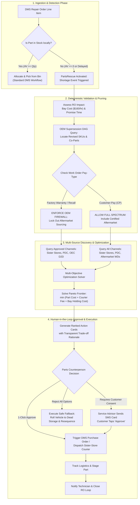

# PartsRescue PR2: End-to-End Operational Workflow Specification

**Workspace:** Tekion Tek-Qubit Hackathon 2026  
**Document:** `research/partsrescue-pr2-operational-workflow.md`  
**Phase:** PR2 — Product Opportunity Definition & Technical Architecture Specification  
**Standard Compliance:** `.cursor/rules/research-standards.mdc`, `.cursor/rules/tekion-context.mdc`  
**Design Authority:** Enterprise Workflow Automation Engineer, Senior Dealership DMS Integration Architect  
**Date:** November 14, 2026  
**Focus:** 15-Step Operational Lifecycle, Swimlane Mechanics, and Mermaid System Diagrams  

---

## 1. 15-Step Operational Lifecycle Specification

Every step in the PartsRescue operational recovery pipeline is explicitly categorized by its processing nature:
* **[AUTOMATED]:** System event listener or data pipeline task.
* **[DETERMINISTIC]:** Rule-based logic, schema verification, or database relational query (zero LLM hallucination).
* **[OPTIMIZATION]:** Mathematical trade-off solver (Pareto frontier / constraint optimization).
* **[AI-ASSISTED]:** NLP diagnostic notes parsing, natural-language explanation formatting, or SMS drafting.
* **[HUMAN-GATE]:** Mandatory human-in-the-loop sign-off before financial commitment or operational execution.

```
+========================================================================================================================+
|                                    15-STEP OPERATIONAL RECOVERY PIPELINE TABLE                                         |
+----+----------------------+--------------------+--------------------+--------------------+-----------------------------+
| #  | Step Title           | Nature of Process  | Trigger & Input    | Processing Entity  | Output & Failure Fallback   |
+----+----------------------+--------------------+--------------------+--------------------+-----------------------------+
| 01 | **RO Line Creation** | [AUTOMATED]        | Tech/Advisor adds  | DMS Adapter / Line | Normalized RO line record;  |
|    |                      |                    | parts line in DMS  | Listener           | Fallback: Retry polling.    |
+----+----------------------+--------------------+--------------------+--------------------+-----------------------------+
| 02 | **Part Identified**  | [DETERMINISTIC]    | Tech specifies OEM | Parts Master DB /  | Normalized part SKU & qty;  |
|    |                      |                    | part number & qty  | VIN Decoder        | Fallback: Flag unverified.  |
+----+----------------------+--------------------+--------------------+--------------------+-----------------------------+
| 03 | **Inventory Check**  | [DETERMINISTIC]    | Part SKU queried   | DMS Inventory      | `OH`, `AL`, `AV` status;    |
|    |                      |                    | in local store DB  | Master Service     | In-stock $\to$ Standard pick|
+----+----------------------+--------------------+--------------------+--------------------+-----------------------------+
| 04 | **Shortage Detected**| [AUTOMATED]        | Available qty = 0  | Event Orchestrator | **PartsRescue Activated**;  |
|    |                      |                    | or ETA > promise   | Listener           | Log event timestamp.        |
+----+----------------------+--------------------+--------------------+--------------------+-----------------------------+
| 05 | **RO Impact Audit**  | [DETERMINISTIC]    | Pulls RO promise   | Service Context    | Bay holding rate ($/hr) and |
|    |                      |                    | time, bay #, tech  | Evaluator          | customer delay penalty cost.|
+----+----------------------+--------------------+--------------------+--------------------+-----------------------------+
| 06 | **Fitment & Super-** | [DETERMINISTIC]    | Traverses OEM DAG  | Catalog Validation | List of verified replacement|
|    | **session Validate** |                    | & ACES attributes  | Engine             | SKUs + co-dependent hardware|
+----+----------------------+--------------------+--------------------+--------------------+-----------------------------+
| 07 | **Eligibility Check**| [DETERMINISTIC]    | Checks RO pay-type | Warranty Firewall  | Filtered sourcing rules     |
|    |                      |                    | (Warranty vs CP)   | Engine             | (OEM-only vs Aftermarket).  |
+----+----------------------+--------------------+--------------------+--------------------+-----------------------------+
| 08 | **Sourcing Discovery| [AUTOMATED]        | Concurrently queries| Multi-Source Sourcing| Raw candidate offers:     |
|    |                      |                    | sister, PDC, local | Connectors         | price, stock count, & ETA.  |
+----+----------------------+--------------------+--------------------+--------------------+-----------------------------+
| 09 | **Hard Filtering**   | [DETERMINISTIC]    | Eliminates invalid | Candidate Pruning  | Verified feasible candidates|
|    |                      |                    | or non-compliant   | Filter             | (If 0 $\to$ Trigger Step 13D)|
+----+----------------------+--------------------+--------------------+--------------------+-----------------------------+
| 10 | **Multi-Objective**  | [OPTIMIZATION]     | Solves cost vs ETA | Discrete Trade-Off | Pareto-ranked candidates with|
|    | **Optimization**     |                    | vs bay dead time   | Optimizer          | computed utility scores.    |
+----+----------------------+--------------------+--------------------+--------------------+-----------------------------+
| 11 | **Rec. Generation &**| [AI-ASSISTED]      | Formats trade-offs | Explanation Agent /| Visual Action Card + draft  |
|    | **Customer Consent** | [HUMAN-GATE]       | & customer SMS;    | Card Generator &   | customer authorization SMS. |
|    |                      | (Conditional)      | advisor sends SMS  | Service Advisor    | (If approved: RO updated).  |
+----+----------------------+--------------------+--------------------+--------------------+-----------------------------+
| 12 | **Procurement Sign-**| [HUMAN-GATE]       | Counter staff sees | Parts Counter &    | Selected Action Approved    |
|    | **Off (Staff Only)** | (Mandatory)        | verified options   | Parts Manager      | (Requires authorized staff).|
+----+----------------------+--------------------+--------------------+--------------------+-----------------------------+
| 13 | **Action Execution** | [AUTOMATED]        | Staff sign-off     | Sourcing Action    | Draft PO posted in DMS;     |
|    |                      |                    | triggers write-back| Dispatcher         | courier dispatched via API. |
+----+----------------------+--------------------+--------------------+--------------------+-----------------------------+
| 14 | **Fulfillment Track**| [AUTOMATED]        | Courier transit &  | Logistics Tracker  | In-transit alerts; physical |
|    |                      |                    | receiving dock scan| & Staging Service  | staging bin tag printed.    |
+----+----------------------+--------------------+--------------------+--------------------+-----------------------------+
| 15 | **Outcome Recorded** | [AUTOMATED]        | Tech punches back  | Closed-Loop        | Telemetry logged: bay hours |
|    |                      |                    | on job; RO closed  | Telemetry Logger   | saved, cost variance, CSI.  |
+========================================================================================================================+
```

---

## 2. End-to-End System Workflow Diagram



---

## 3. Operational Sequence Diagram (Cross-Functional Swimlanes)

```mermaid
sequenceDiagram
    autonumber
    actor Tech as Technician
    participant DMS as DMS / Shop Board
    actor Parts as Parts Counterperson
    participant Agent as PartsRescue Engine
    actor Advisor as Service Advisor
    actor Cust as Customer (SMS)
    participant Supplier as Wholesale / Sister Store

    Tech->>DMS: Flags missing part on active RO #4012
    DMS->>Agent: Shortage Webhook: Part #XR3Z-8501-AA (0 in stock)
    
    activate Agent
    Agent->>DMS: Query RO #4012 context (Bay 4, Tech Mike, CP repair)
    Agent->>Agent: Deterministic check: OEM Supersession -> XR3Z-8501-AB
    Agent->>Agent: ACES check: Certified Aftermarket = Gates #42088
    Agent->>Supplier: Concurrent Sourcing Query (Sister Store B vs NAPA)
    Supplier-->>Agent: Sister Store: $110 OE, 45-min courier ($15 fee)<br>NAPA: $75 Aftermarket, 25-min delivery ($0 fee)
    Agent->>Agent: Multi-Objective Optimization Solver:<br>Option B saves customer $45, avoids 3.5 hrs bay dead time
    Agent->>Parts: Present Ranked Action Card on Counter Console
    deactivate Agent

    Parts->>Parts: Counterperson reviews & selects Option B (Aftermarket)
    Parts->>Advisor: Forward digital authorization card to Advisor
    Advisor->>Cust: 1-Click Send: SMS Approval Card ($45 savings, on time)
    Cust-->>Advisor: Customer taps "APPROVE AFTERMARKET" on mobile
    Advisor->>Parts: Digital consent recorded in audit log
    
    Parts->>Supplier: 1-Click Electronic PO dispatched to NAPA
    Supplier-->>Parts: Courier dispatched (ETA: 22 minutes)
    Parts->>DMS: Update RO dispatch: "Parts In-Transit — Staging at 10:45 AM"
    Supplier->>Parts: Part delivered at dock; barcode scanned
    Parts->>Tech: Automated bay alert: "Part staged in Bin RO-4012"
    Tech->>DMS: Tech punches back on job; reassembly completed
```

---

## 4. Operational Failure Paths & Fallback Behavior

```
+========================================================================================================================+
|                                    WORKFLOW FAILURE PATHS & SAFE FALLBACKS                                             |
+----+--------------------------------+-----------------------+----------------------------------------------------------+
| #  | Failure Scenario               | Detection Mechanism   | Automated System Fallback & Recovery Action              |
+----+--------------------------------+-----------------------+----------------------------------------------------------+
| 01 | **Zero Feasible Candidates**   | Step 09 Filter yields | **Trigger Labor Resequencing Workflow:** Alerts shop     |
|    | (Part globally unavailable)    | null candidate set    | dispatcher; directs porter to stage car in holding yard; |
|    |                                |                       | reassigns technician to in-stock maintenance RO.         |
+----+--------------------------------+-----------------------+----------------------------------------------------------+
| 02 | **Customer Declines Alt**      | Customer taps "DENY"  | **Fallback to OEM Backorder:** System pauses aftermarket |
|    | (Customer-Pay substitution)    | on interactive SMS    | procurement; routes order to OEM PDC backorder queue;   |
|    |                                |                       | updates customer promise date to standard freight arrival|
+----+--------------------------------+-----------------------+----------------------------------------------------------+
| 03 | **Courier Transit Spike**      | Logistics Tracker     | **Dynamic Re-Optimization:** Re-calculates bay cost; if  |
|    | (Courier delayed by 2 hours)   | receives transit lag  | delay exceeds 90 mins, alerts dispatcher to reassign     |
|    |                                |                       | technician to secondary bench task while vehicle waits.  |
+----+--------------------------------+-----------------------+----------------------------------------------------------+
| 04 | **Supplier Stock Ghosting**    | Supplier returns OOS  | **Instant Sourcing Fallback:** Agent automatically moves |
|    | (Reported stock was phantom)   | upon electronic PO    | to Candidate Rank 2 (e.g. Sister Store B) and alerts     |
|    |                                |                       | parts counterperson for 1-click re-authorization.        |
+========================================================================================================================+
```
