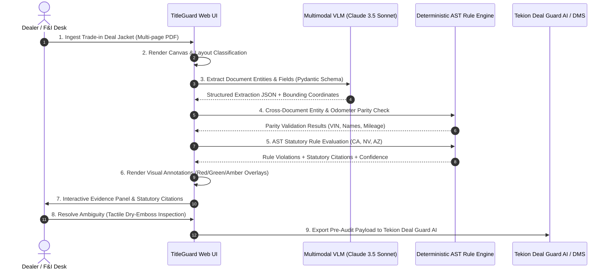

# CrossBorder TitleGuard: 5-Minute Live Demonstration Scenario Specification

**Document Version:** 1.0  
**Phase:** 4 — Final Concept Selection, Product Definition & Scope Freeze  
**Concept Reference:** Concept C1 — CrossBorder TitleGuard  
**Status:** Approved for Scope Freeze  
**Author:** AI Solution Architect & Technical Review Committee  

---

## 1. Executive Demonstration Overview

This document specifies the exact 9-step, 5-minute live demonstration sequence for **CrossBorder TitleGuard** for the Tekion Tek-Qubit Hackathon 2026 presentation.

### 1.1 Demonstration Objectives
1. **Prove Defensibility & Novelty:** Demonstrate that showroom intake title verification solves a major dealership bottleneck ($25,000–$45,000 CIT capital freeze per deal) using neuro-symbolic AI (Multimodal VLM perception + deterministic AST statutory rule enforcement).
2. **Visual Impact for Hackathon Judges:** Deliver immediate visual feedback (bounding boxes, side-by-side mismatch highlighting, exact statutory citations) rather than generic chat or black-box predictions.
3. **Operational Feasibility:** Show human-in-the-loop escalation for edge cases (e.g., colorless dry-embossed seals) and seamless handoff to Tekion Deal Guard AI / ARC DMS.

### 1.2 Time Budget (300 Seconds Total)
- **Introduction & Intake Setup:** 0:00 – 0:45 (45s)
- **Live Ingestion & Processing:** 0:45 – 1:45 (60s)
- **Defect Detection & Statutory Explanation:** 1:45 – 3:15 (90s)
- **Ambiguity Handling & Human Escalation:** 3:15 – 4:15 (60s)
- **Summary Export & ROI Conclusion:** 4:15 – 5:00 (45s)

---

## 2. Nine-Step Demonstration Sequence



---

### Step 1: Ingestion of Customer-Held Trade-In Deal Jacket
- **User Action:** Presenter selects an out-of-state customer trade-in deal jacket (a standardized synthetic 3-page scan containing zero real-world PII: synthetic Arizona Certificate of Title, ADOT Bill of Sale Form 48-2004, and Dealer Reassignment). Presenter drags and drops `deal_jacket_AZ_trade_synthetic.pdf` into the TitleGuard intake dropzone.
- **System Response:** Document ingestion service captures file, verifies PDF integrity, creates session hash, and splits document into isolated high-resolution page buffers (300 DPI PNGs).
- **What Judges See:** Modern, high-contrast dashboard with an animated ingestion card showing file name, file size (4.2 MB), 3 pages detected, and synthetic trade-in metadata (Deal #TK-8492, Sales Rep: M. Rodriguez, Customer: Eleanor Vance).
- **Execution Time Target:** 5 seconds (Cumulative: 0:50).
- **Fallback Path:** If file upload stalls, a pre-cached offline sample jacket button ("Load Sample AZ Deal Jacket") activates immediately with zero network latency.

---

### Step 2: Document Canvas Rendering & Layout Classification
- **User Action:** Presenter clicks "Initiate TitleGuard Intake Audit".
- **System Response:** Document classification model detects document typology:
  - Page 1: Arizona Certificate of Title (ADOT Form 96-0236B rev. 2018).
  - Page 2: ADOT Bill of Sale (Form 48-2004).
  - Page 3: Dealer Reassignment Sheet.
- **What Judges See:** A split-screen layout. Left pane: High-fidelity document viewer displaying Page 1. Right pane: Live Processing Status Pipeline with real-time step checkmarks ("Document Typology Classified: Arizona Title System").
- **Execution Time Target:** 3 seconds (Cumulative: 0:53).
- **Fallback Path:** If typology classifier returns confidence $< 0.85$, UI defaults to manual dropdown selection with pre-selected "AZ Certificate of Title".

---

### Step 3: Multimodal VLM Extraction (Pydantic Schema)
- **User Action:** Automated execution (no user intervention required). Presenter explains: *"Under the hood, TitleGuard routes the image to Claude 3.5 Sonnet using our strict Pydantic JSON schema to extract title numbers, VIN, party legal names, odometer declarations, and notary signature blocks."*
- **System Response:** VLM extracts structured attributes along with normalized 2D bounding polygon coordinates (`[ymin, xmin, ymax, xmax]`) for every field.
- **What Judges See:** Real-time extraction drawer slides open displaying structured key-value pairs populating dynamically:
  - `vin`: `1HGCR2F83HA019482` (Checksum Valid)
  - `vehicle`: `2017 HONDA ACCORD EX-L`
  - `seller`: `ELEANOR MARIE VANCE`
  - `buyer`: `DESERT SKY MOTORS LLC`
  - `odometer`: `68,412` (Status: Actual Mileage)
  - `notary_present`: `False` (Bill of Sale Form 48-2004)
- **Execution Time Target:** 6 seconds (Cumulative: 0:59).
- **Fallback Path:** In case of LLM API timeout or rate limiting, system serves deterministic pre-extracted synthetic JSON fixture matched to the sample PDF hash.

---

### Step 4: Entity and Odometer Parity Check
- **User Action:** Automated execution. Presenter points to the cross-document reconciliation card.
- **System Response:** Deterministic parity engine executes string distance algorithms (Levenshtein distance & Jaro-Winkler) and odometer continuity checks across Page 1, Page 2, and the DMS Deal Jacket feed:
  - VIN parity across all pages: $100\%$ match (`1HGCR2F83HA019482`).
  - Legal name parity: `ELEANOR MARIE VANCE` on Title vs `ELEANOR M. VANCE` on Bill of Sale ($94\%$ Jaro-Winkler similarity; flagged as alias match).
  - Odometer progression: Title history (42,100 mi in 2021) $\to$ Current disclosure (68,412 mi in 2026) $\to$ Monotonic increase verified.
- **What Judges See:** Green checkmark badge on VIN Parity and Odometer Progression; informational pill on Legal Name ("Minor Name Variation Approved: Middle Name Abbreviation").
- **Execution Time Target:** 2 seconds (Cumulative: 1:01).
- **Fallback Path:** If string comparison exceeds threshold, UI marks entity as "DISCREPANCY DETECTED" and highlights mismatched characters in yellow.

---

### Step 5: AST Statutory Rule Evaluation (CA, NV, AZ)
- **User Action:** System evaluates transaction rules against frozen Arizona statutory rulebook. Presenter explains: *"TitleGuard does not ask an LLM to guess title law. An Abstract Syntax Tree evaluates deterministic statutory predicates based on Arizona ADOT regulations."*
- **System Response:** Rule engine applies rules:
  - `FED-ODO-01`: PASS (Federal 20-year exemption check: 2017 model requires disclosure; valid disclosure present).
  - `AZ-TITLE-01`: PASS (Title certificate reassignment section completed without uncertified alterations).
  - `AZ-BOS-02`: **FAIL — FATAL DEFECT** (ADOT Bill of Sale Form 48-2004 lacks notary acknowledgment or authorized MVD/ATP officer witness signature).
- **What Judges See:** Red Alert Banner: **"CRITICAL REJECTION RISK: Missing Notary Acknowledgment on ADOT Bill of Sale Form 48-2004 (A.R.S. § 28-2058 / ADOT Policy Section 2.1.2)"**.
- **Execution Time Target:** 2 seconds (Cumulative: 1:03).
- **Fallback Path:** Deterministic rule tree executes locally in Python/Node; no external dependency.

---

### Step 6: Visual Annotation with Bounding Overlays
- **User Action:** Presenter clicks on the red alert card.
- **System Response:** Document canvas automatically scrolls to Page 2 (ADOT Form 48-2004), zooms in on the Signature & Acknowledgment Block (coordinates `[0.72, 0.15, 0.91, 0.85]`), and paints an interactive red overlay box.
- **What Judges See:** A crisp red bounding box around the empty "Notary Public / Authorized Officer Signature" line. A tooltip appears: *"Signature present for Eleanor Vance; Notary jurat and seal missing. Title rejection probability: 100% at ADOT MVD."*
- **Execution Time Target:** 1 second (Cumulative: 1:04).
- **Fallback Path:** If bounding box coordinates fail rendering, canvas displays full page view with highlighted banner pointing to Section C.

---

### Step 7: Evidence Explanation & Statutory Citations
- **User Action:** Presenter clicks "View Legal Evidence & Remediation".
- **System Response:** Slide-over panel provides legal backing and immediate dealership operational instructions.
- **What Judges See:**
  - **Statutory Authority:** *Arizona Revised Statutes § 28-2058 & ADOT Title Manual Rev. 2024.*
  - **Rejection Consequence:** *Title will be rejected by ADOT MVD. Dealership CIT frozen: $32,450. Estimated title turnaround delay: 18–25 days.*
  - **Actionable Remediation Checklist for F&I Desk:**
    - [ ] Option A: Obtain on-site notarization from Eleanor Vance before she departs the showroom (Notary on duty: J. Miller, Office #104).
    - [ ] Option B: Have licensed dealership ATP representative witness Eleanor Vance's signature pursuant to A.R.S. § 28-370.
- **Execution Time Target:** 3 seconds (Cumulative: 1:07).
- **Fallback Path:** Static legal reference cards available in offline cache.

---

### Step 8: Ambiguity Handling & Tactile Seal Escalation
- **User Action:** Presenter clicks "Test Ambiguity Scenario: Nevada Embossed Title". Presenter selects an older Nevada title specimen (`deal_jacket_NV_trade.pdf`).
- **System Response:** VLM processes Nevada Certificate of Title (Pre-2019 format). VLM detects notary stamp text and signature, but detects low-contrast circular artifact consistent with a colorless raised dry-embossed seal. VLM assigns confidence score of $0.62$ (below automated approval threshold $\ge 0.90$).
- **What Judges See:**
  - Amber Warning Banner: **"VERIFICATION REQUIRED: Potential Dry-Embossed Notary Seal Detected"**.
  - System highlights the notary block in amber dashed lines.
  - Interactive Action Modal displays: *"Flatbed scanning cannot reliably verify colorless raised dry-embossed seals. Please physically inspect the paper title. Does the physical document have an embossed seal over the notary signature?"*
  - Presenter clicks **"Confirm Embossed Seal Present (Physical Title Inspected)"**. Clerk ID is logged (`CLERK_ID: TC-4091`). Status converts from Amber to Green Verified.
- **Execution Time Target:** 15 seconds (Cumulative: 1:22).
- **Fallback Path:** Manual override button with mandatory reason code selection ("Physical seal confirmed", "Power of attorney attached", "Rejected for re-signing").

---

### Step 9: Pre-Audit Summary Export to Tekion Deal Guard AI (Conceptual Integration)
- **User Action:** Presenter clicks "Approve Deal Jacket & Prepare Tekion Sync".
- **System Response:** TitleGuard generates a tamper-evident, digitally signed Pre-Audit Summary JSON payload formatted for Tekion ARC DMS ingestion.
- **What Judges See:**
  - Deal status changes to **"Pre-Audit Complete: No Detected Deficiencies (Cleared for Desk Review)"**.
  - A modal preview displays the proposed Tekion integration payload:
    ```json
    {
      "deal_id": "TK-8492",
      "pre_audit_status": "PRE_AUDIT_PASS",
      "discrepancies_detected": 0,
      "title_guard_audit_id": "TG-2026-AZ-0914",
      "risk_score": 0.04,
      "cit_release_recommended": true,
      "tamper_evident_hash": "e3b0c44298fc1c149afbf4c8996fb92427ae41e4649b934ca495991b7852b855",
      "audit_trail_url": "https://dms.tekion.cloud/deal-guard/audit/TG-2026-AZ-0914"
    }
    ```
  - Presenter delivers closing line: *"By catching title defects while the customer is sitting at the showroom desk, TitleGuard turns a 21-day $30,000 CIT capital hold into an immediate 3-minute on-site remedy. It closes the physical-to-digital loophole in Tekion Deal Guard AI."*
- **Execution Time Target:** 5 seconds (Cumulative: 1:27).
- **Fallback Path:** Downloadable PDF Pre-Audit Summary Report generated locally for offline inspection.

---

## 3. Demonstration Test Case Matrix

The live demonstration utilizes three rigorously defined synthetic test cases stored as standardized mock datasets:

| Test Case ID | Document Profile | Injected Conditions | Expected VLM & AST Behavior | Judge Takeaway |
| :--- | :--- | :--- | :--- | :--- |
| **TC-DEMO-01** (Clean Arizona Trade) | Synthetic Arizona Certificate of Title + Form 48-2004 Bill of Sale | Clean signatures, matching VIN, odometer disclosure valid, dealer witness stamp present. | All AST rules pass. Green verification badge (`PRE_AUDIT_PASS`). Processing time $< 8\text{ seconds}$. | Shows speed, automated precision, and frictionless workflow for compliant deals. |
| **TC-DEMO-02** (Planted Statutory Defect) | Synthetic Arizona Bill of Sale Form 48-2004 accompanying Title | Seller Eleanor Vance signed, but notary jurat is empty; no ATP witness signature. | AST rule `AZ-BOS-02` triggers Fatal Failure. Red bounding box over signature block. Cites A.R.S. § 28-2058. | Proves deep domain intelligence. Solves the exact error that causes 3-week CIT freeze and unwinds. |
| **TC-DEMO-03** (Ambiguous Seal Case) | Synthetic Nevada Certificate of Title (Older Format) | Clear notary signature, faint circular indentation, colorless raised seal. | VLM confidence $0.62$. AST routes to Human-in-the-Loop escalation modal. Clerk tactile sign-off required. | Demonstrates engineering maturity: never hallucinates compliance; safely escalates physical realities. |

---

## 4. UI Layout & Visual Cue Wireframe

```
+----------------------------------------------------------------------------------------------------+
|  TEKION ARC | CrossBorder TitleGuard v1.0                     Deal #TK-8492 | Cust: E. Vance     |
+----------------------------------------------------------------------------------------------------+
|  [ DOCUMENTS ]        |  DOCUMENT CANVAS VIEW                     |  DEFECT & COMPLIANCE AUDIT     |
|                       |                                           |                                |
|  [x] Page 1: AZ Title |  +-------------------------------------+  |  STATUS: CRITICAL DEFECT (1)   |
|  [x] Page 2: BillSale |  | STATE OF ARIZONA                    |  |                                |
|  [ ] Page 3: Reassign |  | CERTIFICATE OF TITLE                |  |  [!] RULE AZ-BOS-02 VIOLATION  |
|                       |  | VIN: 1HGCR2F83HA019482              |  |  Missing Notary Jurat/Witness  |
|  -------------------- |  | Odometer: 68,412 mi (Actual)        |  |  ADOT Form 48-2004 Sec. C      |
|  EXTRACTION DATA:     |  |                                     |  |  Statute: A.R.S. § 28-2058     |
|  VIN: Valid (49 CFR)  |  | [ Page 2: ADOT Form 48-2004 ]       |  |                                |
|  Odo: 68,412 (Actual) |  |                                     |  |  REMEDY:                       |
|  Party: E. Vance      |  | Seller: Eleanor M. Vance [SIGNED]   |  |  ( ) Execute on-site notary    |
|  Status: Uncertified  |  | +---------------------------------+ |  |  ( ) Dealer ATP witness sign   |
|                       |  | | [!] MISSING NOTARY SIGNATURE    | |  |                                |
|                       |  | | / SEAL (A.R.S. § 28-2058)       | |  |  ESTIMATED CIT FREEZE:         |
|                       |  | +---------------------------------+ |  |  $32,450 (18-25 Day Delay)     |
|                       |  +-------------------------------------+  |                                |
|                       |  [ Zoom + ] [ Zoom - ] [ Highlight Defect]|  [ RESOLVE & SYNC TO TEKION ]  |
+----------------------------------------------------------------------------------------------------+
```

---

## 5. Demonstration Contingency & Resilience Protocols

| Risk Event | Severity | Mitigation & Technical Fallback |
| :--- | :---: | :--- |
| **VLM API Outage or Latency Spike (>10s)** | High | Standby local mock server (`http://localhost:5000/api/mock/audit`) pre-loaded with exact deterministic JSON responses. Presenter presses `Ctrl+Shift+M` to engage fallback. UI prominently displays: `[DEMO SIMULATION MODE ENGAGED]`. It is an offline presentation safety harness, NOT a substitute for live inference. |
| **Projector / Screen Resolution Mismatch** | Medium | Responsive CSS layout with fixed aspect ratio container (16:9 1080p optimized), with high-contrast color palette accessible under bright auditorium lighting. |
| **Judge Asks About Complex Edge Cases (e.g. Deceased Owner)** | Low | Presenter navigates to Technical Scope panel showing frozen coverage boundary: *"Deceased estates and judicial sales are explicitly flagged as Category 7 complex exceptions, routed directly to the specialized dealership title clerk with our exception checklist."* |
| **Network Loss during Presentation** | High | UI and local FastAPI service run locally in containerized environment; zero WAN connectivity required for fallback execution. |

---

## 6. Demonstration Readiness Checklist

- [x] All 9 sequence steps mapped to exact presentation seconds.
- [x] 3 distinct test cases defined with explicit ground truth and injected errors.
- [x] UI mock layout designed with high-contrast bounding box overlays.
- [x] Clear human-in-the-loop escalation step defined for dry-embossed seals.
- [x] Full offline resilience plan established (zero external network dependency).
